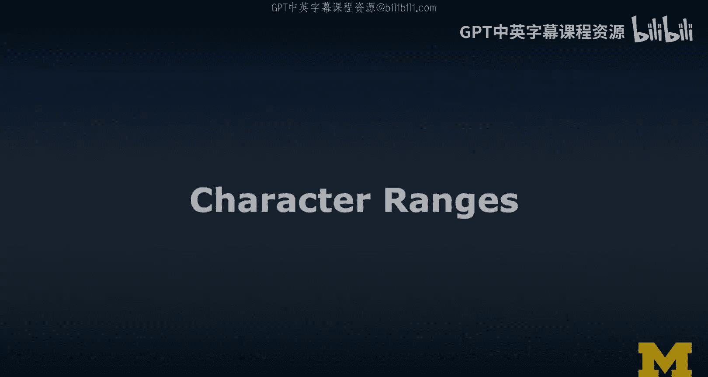
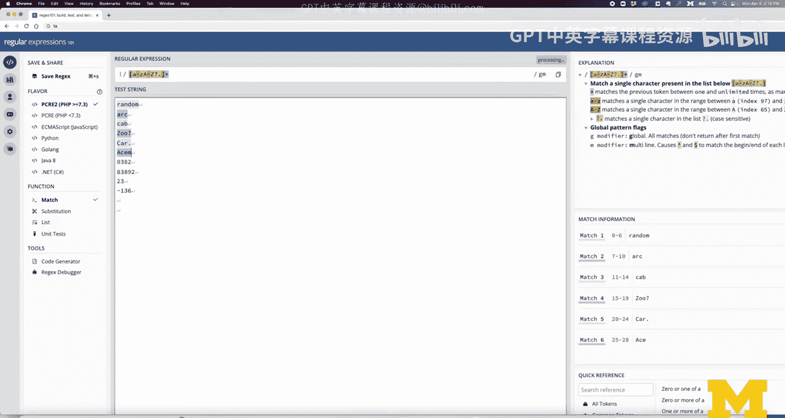
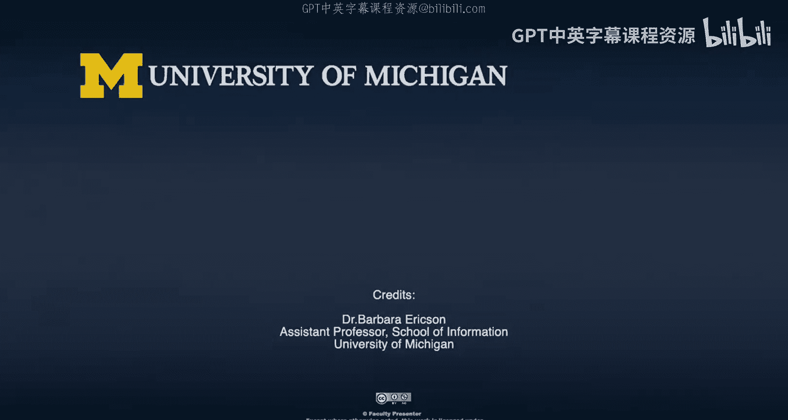

# 密歇根大学《创造性编程（创意、面向对象、debug、QA）｜Creative Coding： Hands-On Python》中英字幕 p125 37_字符范围匹配.zh_en -BV1ef421S7Bc_p125-

So another thing you can have is character ranges or things enclosed in square brackets。

 If they're enclosed in square brackets without a dash between them。

 that just means match any one of those things。 So I could match an A or a C And the start the plus on the outside would say one or more of these。

 So this would match any combinations of just A and C。So I can see I can get C A here， A C。

 but doesn't match anything else。 You can also put a dash in the middle。

 the dash means now arrange from A to C， so that'll batch like cab because ABC。

 or I could say A to Z， which would be all lowercase characters notice it doesn't match an uppercase character then I can also do more than one character range in here so I could say upper and lowercase characters using that And now I see I can match all those。

Interestingly， inside the square brackets special characters like question mark or dot don't match anything other than what they are。

 so they don't mean what they've meant elsewhere， they just mean match the question mark。

 so this would match the question mark if I had a dot here， then it would match whoop。The dot。

 but not any other character。 So not a comma。 So square brackets you can use to say。

 pick match one of these things or one thing in a range。 If I have a dash between things。

 it's arranged from here to here。 And then， of course。

 I can add multipliers on the outside or quantifiers on the outside to say how many of those to match。

