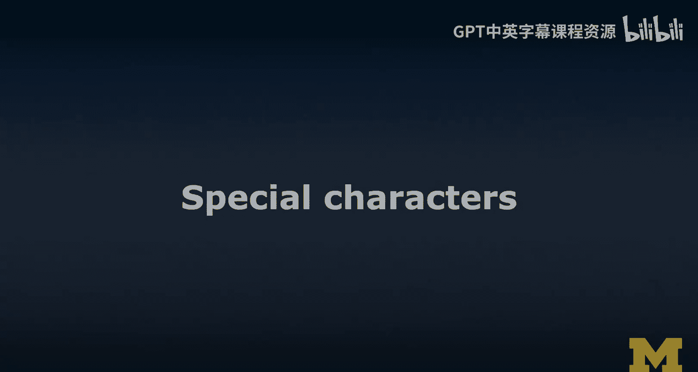
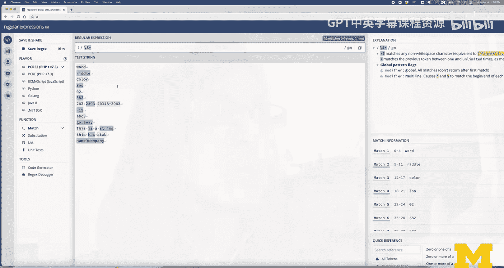
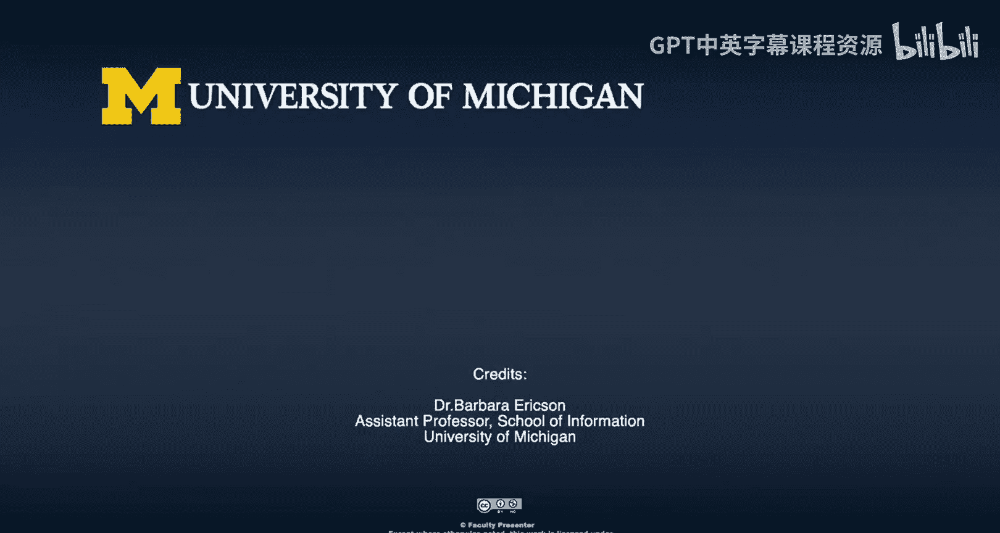
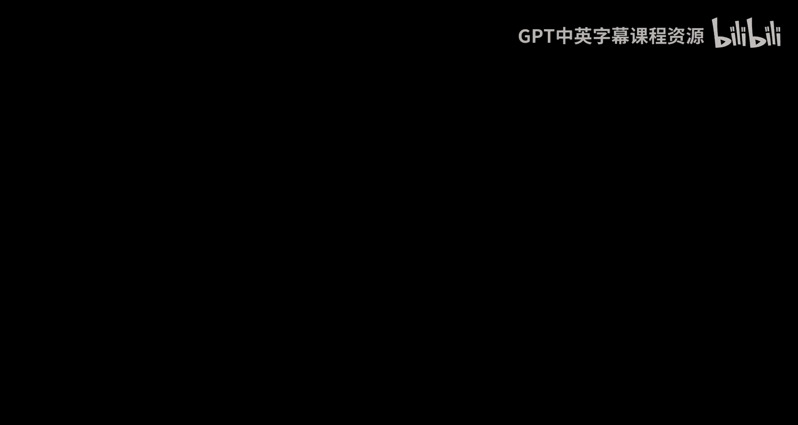

# 密歇根大学《创造性编程（创意、面向对象、debug、QA）｜Creative Coding： Hands-On Python》中英字幕 p126 38_特殊字符处理.zh_en -BV1ef421S7Bc_p126-

So we've already talked about using something like a period as a special character and a period will match anything other than new line。

 So we can see that anything followed by a D was going to match。 And the plus means one or more。

 So we've got anything followed by a D is going to match。 And so we'll see that。

 That's one special character。But you can also， there are several things that have a slash in front of them that are special characters。

 So if I do slash D， that's going to match the equivalent of any digit any value from 0 to 9。

 So notice it doesn't match the minus sign on a negative number。

 but and it doesn't match anything before that， but it does match any digit。

 So I see all those digits。 So Slash D is one of our special characters。 Slash W is another。

 slash W is alpha numeric。 So it matches all lowercase A to Z。

 uppercase A to Z and 0 to 9 as well as underscore。 So you can see that here。

 So we have capital Z is matched that we have underscore being matched here and go away。

 but it doesn't match something like the ampersand。😊，And then there's slash S。

 which is white space sort of thing。 So that's going to match the spaces between things here。

 but it's not going to match other things。 There's also capital of those versions。

 So capital D is non digits。 So that's going to match anything that's not a digit。

 Capital W is anything other than the alphanumeric items so that we'll match， for example。

 this ampersand and then capital S oops。Anything that's non white space。

 so those are the special characters。

