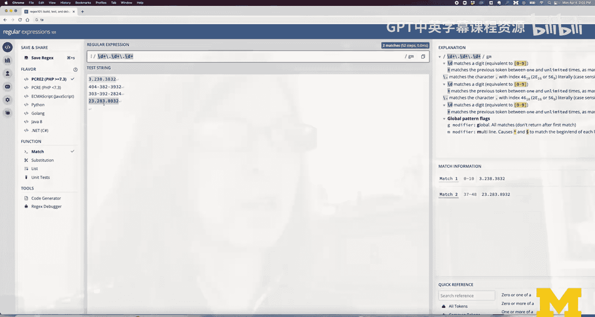
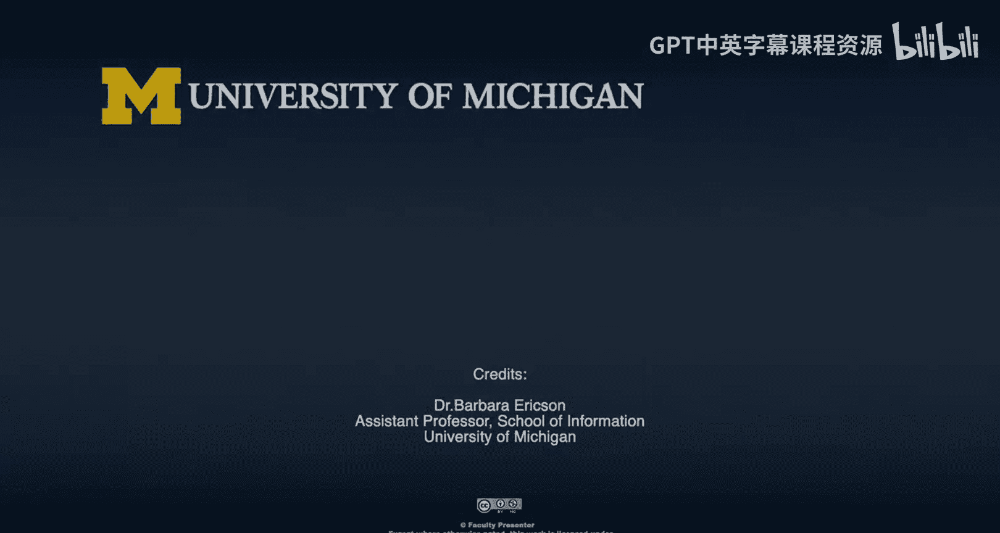

# 密歇根大学《创造性编程（创意、面向对象、debug、QA）｜Creative Coding： Hands-On Python》中英字幕 p127 39_转义字符技巧.zh_en -BV1ef421S7Bc_p127-

So we have those special characters like dot and。Question marks and things。

 So what do we do if we want to actually match one of those。 Let's look at the situation。

 So we've got some numbers with either spaces between them or dots between them or dashes between them。

 And if we just use slash D plus， which means one or more0 to 9 digits followed by a dot means any character followed by again。

 any digits，1 or more， followed by a dot， any character followed by digits one or more。

 we match everything， we match spaces， we match dots， we match dashes。

 what if we'd want to match only if it actually is a period。

 And so if we want to treat a special character as if it's actually the thing。

 Then we put a slash in front of it。So if we have the slash in front of it。

 the only things that match now are things that have one or more digits followed by an actual period。

 followed by one or more digits followed by an actual period。

So that's how you can escape or use the backslash in order to treat special characters as if they were just regular characters。

