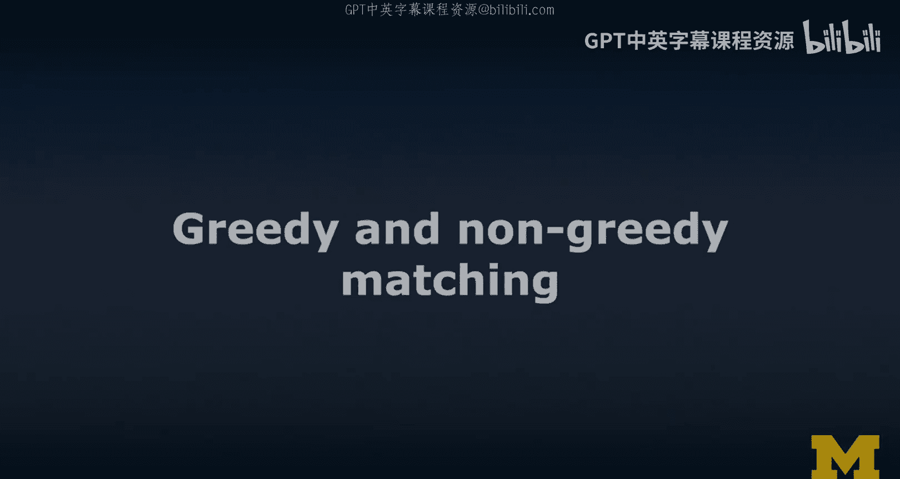
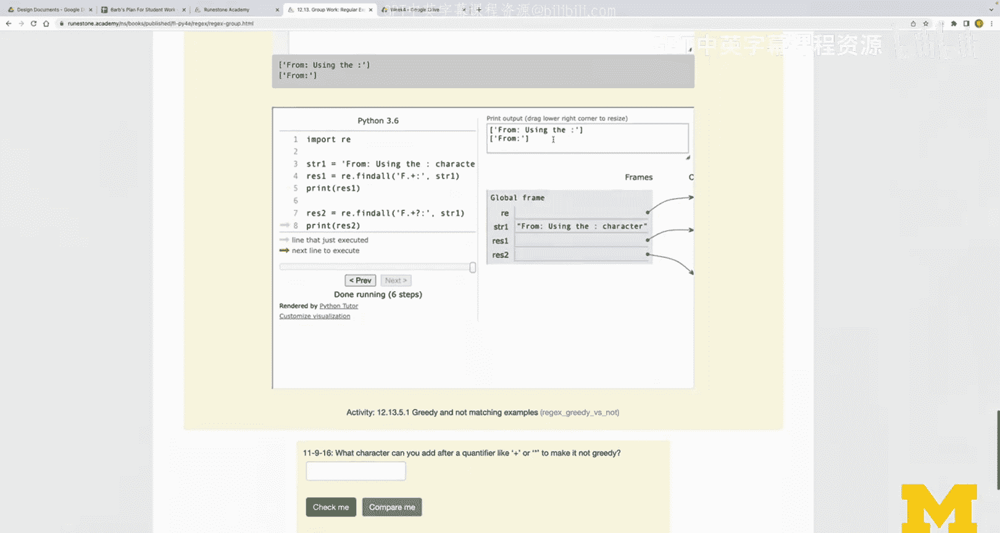

# 密歇根大学《创造性编程（创意、面向对象、debug、QA）｜Creative Coding： Hands-On Python》中英字幕 p128 40_贪婪与非贪婪匹配.zh_en -BV1ef421S7Bc_p128-

So what's the difference between greedy matching and non greedy matching by default。

 it will use greedy matching。 So let's look at this in the code lens， this code。So， of course。

 we import Rri。 and then we have our string and notice it has from colon and then using the colon character。

 So it has colon twice in the string。 So if we do an Rri dot find doll looking for F followed by dot。

 any character one or more times followed by a colon。

 it's going to try to match as much of that as possible。

 and any character is going include white space。 So when I do that， it's a greedy match。

 And then what I get as a result。Is all the way to the second colon。 If I don't want it to be greedy。

 I can put a question mark after the quantifier to say don't make it greedy。

 So question mark right after the plus says don't make it greedy。

 and therefore I get just up to the first colon。 So by default， it's greedy。

 If you want to make it not greedy at a question mark after your quantifier。

