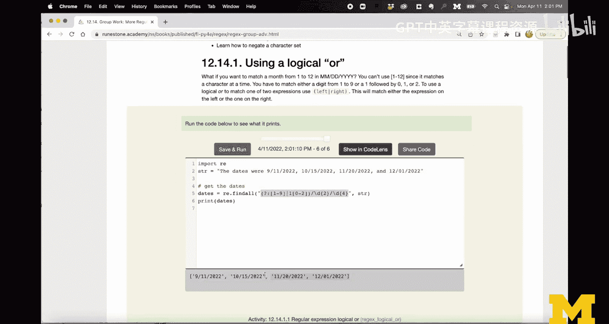
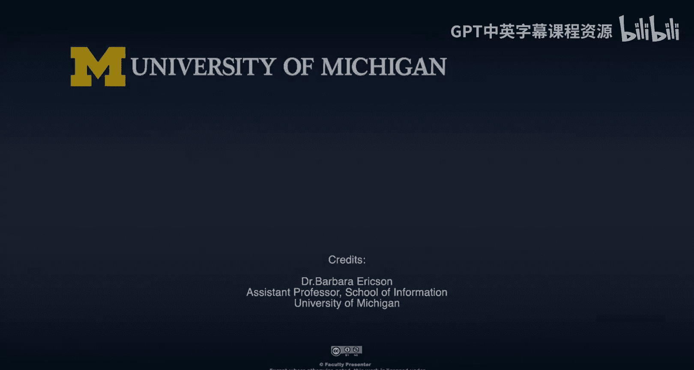

# 密歇根大学《创造性编程（创意、面向对象、debug、QA）｜Creative Coding： Hands-On Python》中英字幕 p129 41_括号使用问题.zh_en -BV1ef421S7Bc_p129-

So when we're using a logical orura， we oftenclose the left and right side in a parentheesis。

 But what happens when we do that？ So notice here we're saying match if we see one to 9 or we see 1 followed by 0 to 2。

 and then a slash slash D。 So the the。At between a month slash then day。 So a digit。

 two digits following in by a slash and then four digits for the year。 But if we run that。

 we see that all that gets returned is the stuff that's in the parentheses。

 So we just get this piece returned。 And that's because parentheses also mean matching groups。

 And so when it sees parentheses， it says， oh， you just want backwards in the parentheses。

So we have a couple of different ways we can handle that。

 one ways we could just add the whole thing to parentheses， put parentheses around the whole thing。

And then that makes everything a matching group。 And so we get back。

 But then we have an outer matching group and an inner matching group。

 And so what we get back is a little different。 What we get back is a list of tuples。

 And in each tuple， the first thing is the full match。 and the second thing is the inner match。

 And you could have more sets of parentheses。 and you get back more of those。😊，This is okay。

 then when we have to， we'd have to loop through this list of topples and pull out that first item。

 If that's what we really want。 Another way to fix it is to tell that instead of putting it inside parentheses。

 the whole thing is just to tell it， hey， don't treat these parentheses as a matching group。

 So we use the question mark colon to say treat this as a non matching group。 And if we do that。

 then we get the entire match for the entire thing。 So you can see we get the full dates。

 So that's two ways to handle that。

