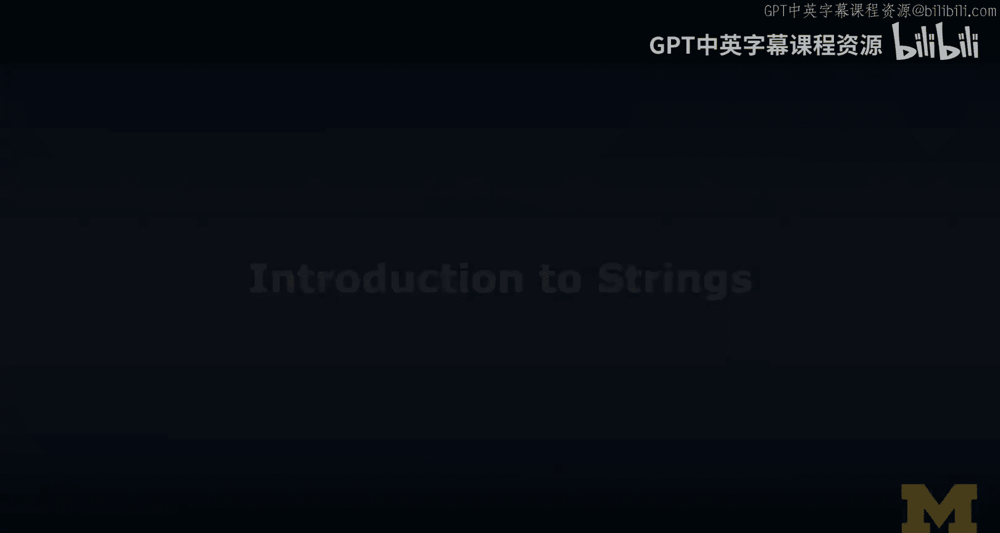
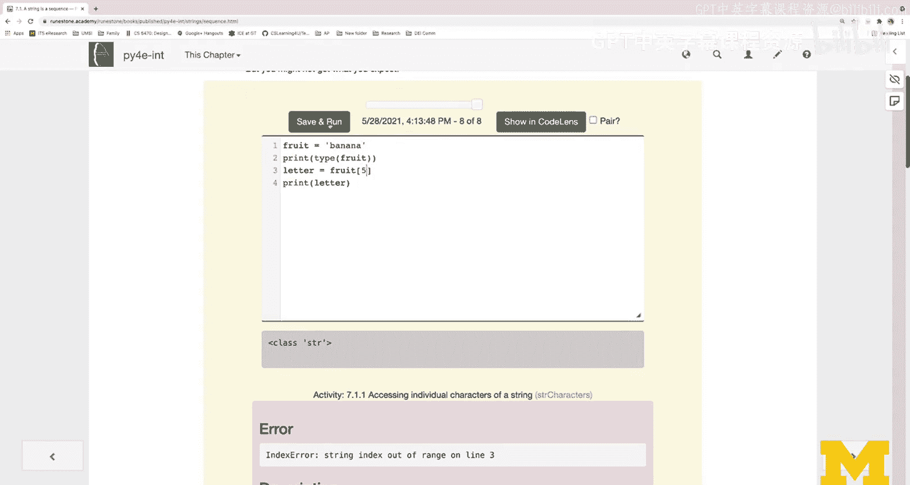
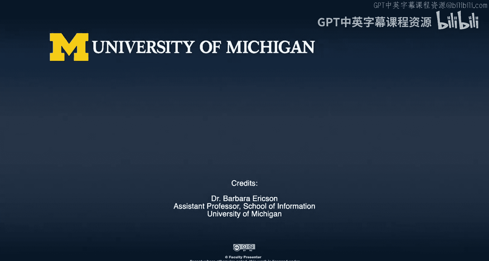

# 密歇根大学《创造性编程（创意、面向对象、debug、QA）｜Creative Coding： Hands-On Python》中英字幕 p13 12_字符串综合解析.zh_en -BV1ef421S7Bc_p13-

So computers can work with lots of different kinds of data， of course they work with numbers。

 they also work with characters or strings。And a string is just a sequence of characters and keeps the order of those characters in Python or in most languages。

 and in Python， you can enclose them in pairs of single quotes or double quotes or even triple quotes。

So take a look at this code。 And what do you think is going to happen when I print this？

 So I have fruit equal banana。 So the single quotes enclosing that string。

 I'm going to print the type of that variable fruit。

 Then I'm going to say the letter equals fruit of index 1。 And then I'm going to print that letter。

 So what letter do you think is going to get printed。So this is going to print a class is string。

 STR for string。 and then the letter that it prints a。

 which is actually at index1 in this string because indexing in string starts at 0， not at one。

 So if I had change this to0 and rerun it， I would see now the B。

 What do you think is going to happen if I actually try index 6。

 which because there's six characters in this string。

 If I do that actually get an index out of range problem。

 because the last valid index is actually at。Index 5， so one less than the length of the string。

So I see that that will work。 So remember that that when you're working with strings that the first element in the string is at index 0。

 and the last one is that the length of the string -1。

