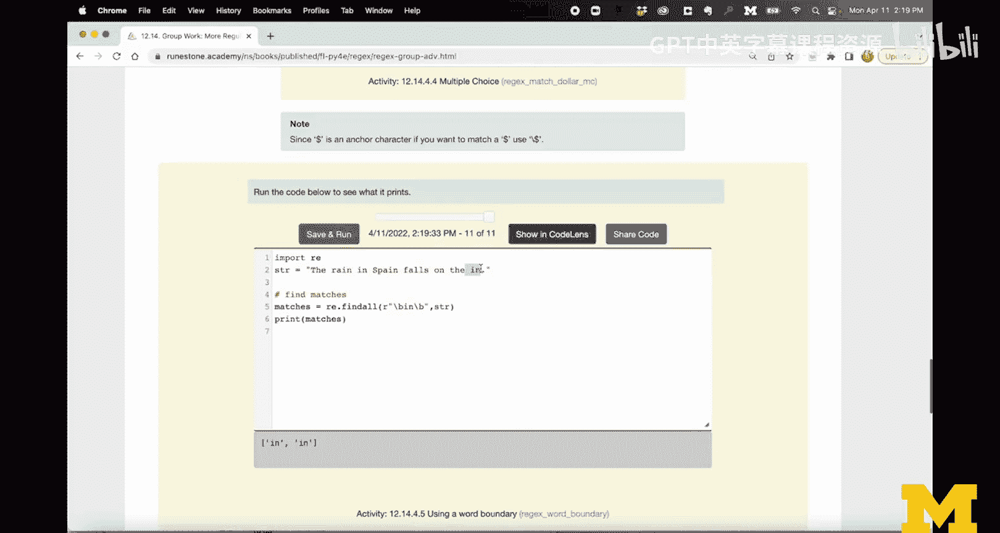
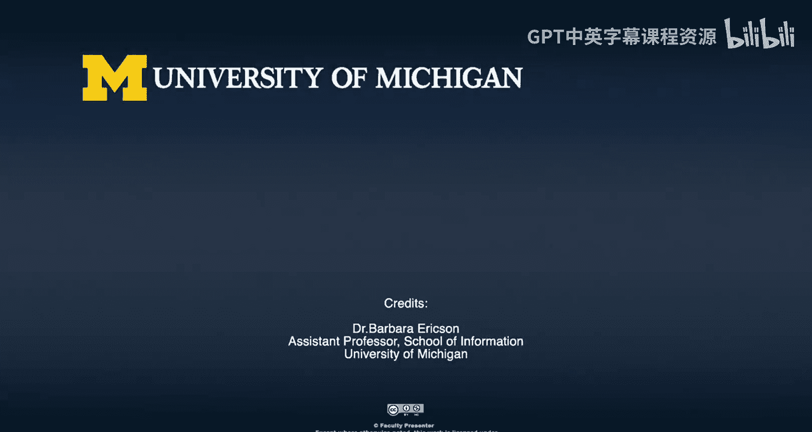

# 密歇根大学《创造性编程（创意、面向对象、debug、QA）｜Creative Coding： Hands-On Python》中英字幕 p130 42_锚点应用解析.zh_en -BV1ef421S7Bc_p130-

So another set of special characters or anchor or boundary characters。 So look at this。

 We have several strings here， and we're matching on capital F R O M colon， followed by a space。

 followed by one or more alpha numeric characters with an underscoreco， potentially。

 But the car in the front。 What does that do。 So I see I have the from colon several times here in these strings。

😊，And again here， But if I run it， I see it only matches this very first one。

 So what the carrot means is only match it if it matches the beginning of a string。

So notice it doesn't match anything in the second string because it doesn't begin with that from colon if I take out the carrot。

And run it。 I see that it matches now all those in the string。

 So use the carrot if you only want to match the things if they're at the beginning of the string。

Another thing that you can do is add a dollar sign at the end of a string。

 And here we're saying match one or more digits， followed by a period。

 So the slash period means just a period followed by two digits。

 and the dollar sign means at the end of a string。 So I'm going to run this。

 And I see we're only matching that at the end of a string， we're not matching all of it。

 If I get rid of the dollar sign。I'll match now all of those。Now。

 notice because a dollar sign has a special character， if you want to match a dollar sign itself。

 you'll have to use a back slash in front of it。 So I could say， and this doesn't always have that。

 so I could do that。 I want to match it if it exists otherwise optionally。 So beginning the string。

 dollar sign end of a string。 then the other thing that you can have happen is this。

Sometimes you want to match just the letters that you've given it if it's on a word boundary on both sides。

 So I could use spaces here， but that wouldn't always work。 So what if。What if。It ended an in。

If I wanted to match this because it is， it wouldn't match that。

 it would only match this one that the space around it。 So instead。

 what we use often is word boundaries。 And we do that with a slash B。

 And because slash B also means backspace， we treat this as a raw string saying。

 don't pre process the string。So if we do that， now we'd find both of these。

 we'd find this one and this one because the period is also a word boundary。

 so those are some of the anchor characters。

