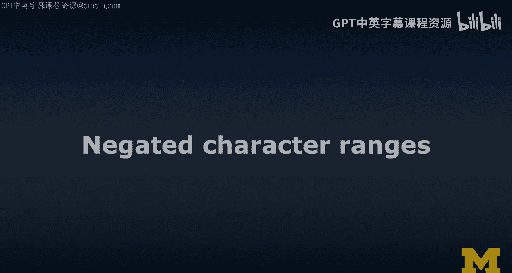
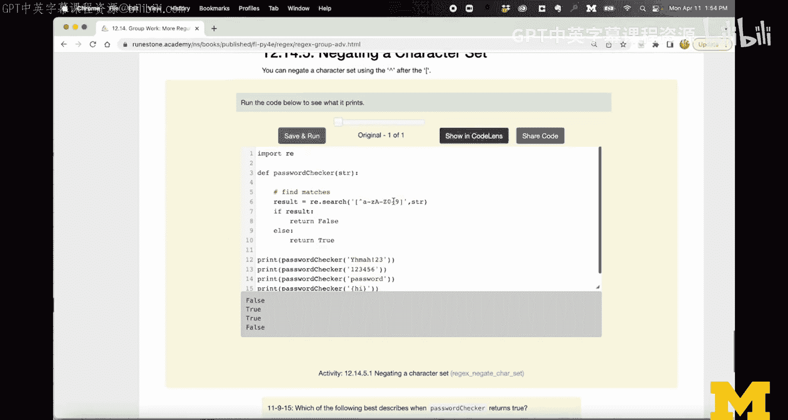
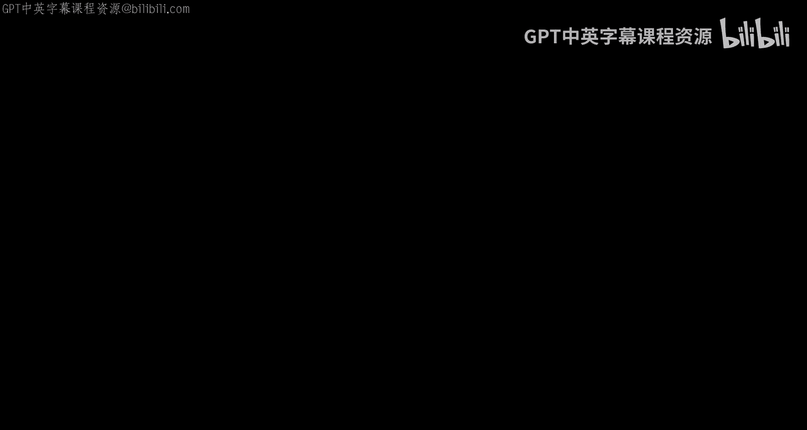
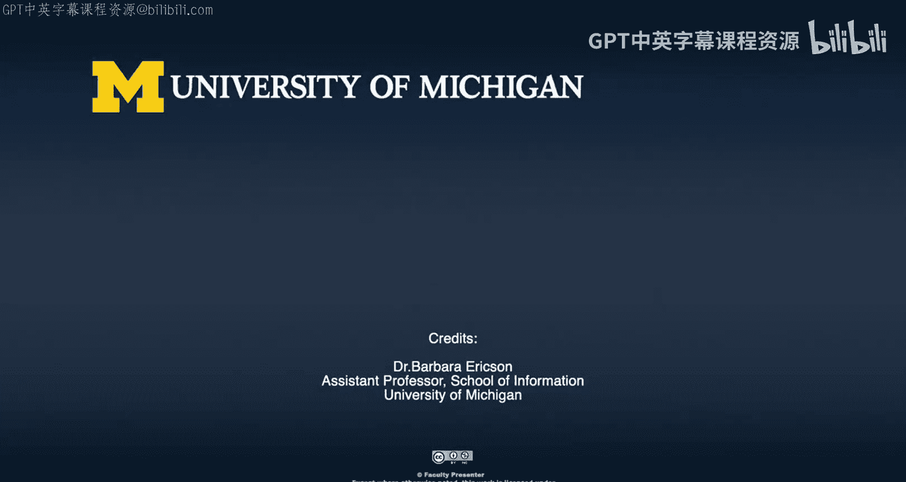

# 密歇根大学《创造性编程（创意、面向对象、debug、QA）｜Creative Coding： Hands-On Python》中英字幕 p131 43_否定字符范围.zh_en -BV1ef421S7Bc_p131-

So you can also negate a character range using the carrot inside the square brackets。

 So here's an example of this。 If we want to check our password to make sure that you are only using lowercase A to Z uppercase A to Z and 0 to 9。

 we can check to see， is there anything other than that。 so we could say， hey。

 search for anything other than that， if it's found， then return false， otherwise return true。

 So if we find anything other than those things， we're going to say then we don't want it， right。

 So if you if you're checking that your password only has those things in it。

 So you can negate a set of character ranges， just add that carrot inside the left square bracket。

