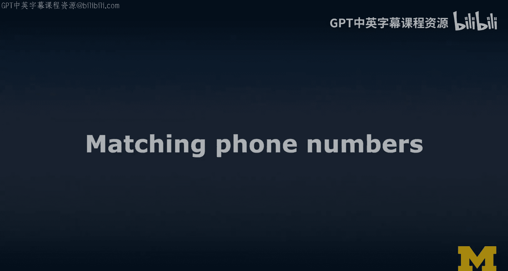
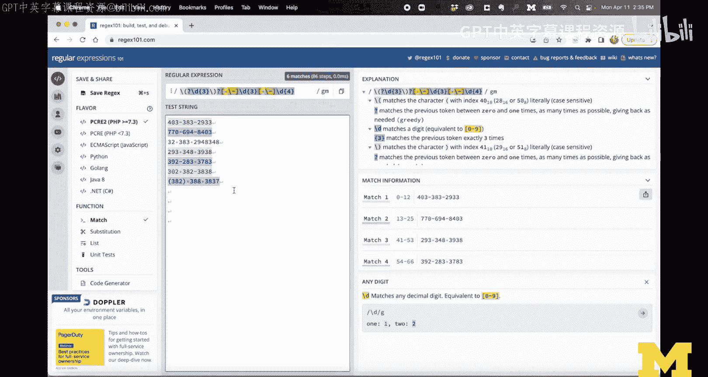
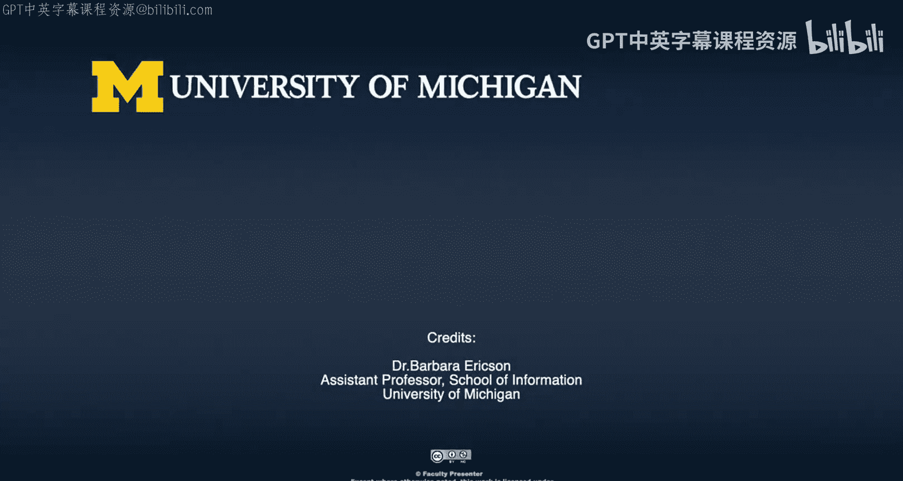

# 密歇根大学《创造性编程（创意、面向对象、debug、QA）｜Creative Coding： Hands-On Python》中英字幕 p132 44_电话号码匹配实践.zh_en -BV1ef421S7Bc_p132-

What if we want to match a phone number？In a phone number， we typically have three digits， and then。

Another three digits and then four digits。 So it might look like this，3 digit stash，3 digit stash。

4 digits。 If we wanted to match that， we could say slash D， which will match a digit。

We could also said in square brackets0 to9 be the same thing as slash D。

 and we can use the curly braces to say we want exactly three， and then if we want a dash。

 we can put the dash between， we can do the same thing again to say we want another three digits with another dash and then four digits。

So that will exactly match those two phone numbers and it won't match things that don't match that pattern。

 so if I have more digits or less digits， it's not going to match。Well。

 do we really always have the dash in a phone number， you may not， So how do you say， well。

 maybe the dash or a space， perhaps so we can use the square brackets to say that that match either dash or spray gotta be a little careful of the dash inside the square brackets because that usually indicates a range so we could backslash it to say no。

 we want to treat it just as a normal thing and I could put a space in front here to say either a space or a dash。

And I can do the same thing here。So now， if I do have just spaces between。It should match。

 which it is， and I could do any combination of a dash here and then a space there。

 and I could do space here and a dash here。 so that's pretty good。

Might also sometimes see phone numbers with parentheses around the first three digits so but not always。

 so if we want optional parentheses。And remember parentheses have special meaning。

 they mean a capturing group。 So if we want to treat it as non a special character。

 we have to backslash it。 So backslash parenthees， I'm going to make a question mark to say optional 0 or one of those。

 And then the same thing on the other side。 So backslash the other parameter and put a question mark on it。

 And then I can check to see that that's working。So now that's matching those things。

 So you can use something like Rex 101 as you're building up an expression。

 I I urge you to start small， match the smallest thing you can， and then just add to it over time。

