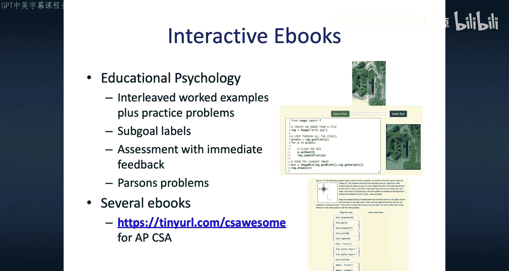
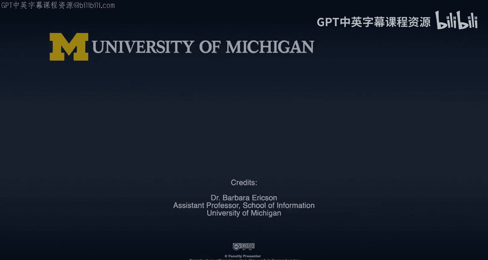

# 密歇根大学《创造性编程（创意、面向对象、debug、QA）｜Creative Coding： Hands-On Python》中英字幕 p133 0_遇见Barb Ericson博士.zh_en -BV1ef421S7Bc_p133-

Let me tell you a bit about myself。 So I'm an assistant professor at the School of Information。

 and I've only been an assistant professor for the last three years。

 but I've been around for a lot longer than that？ So where did I come from？ Well。

 my high school career choices were either to be a vet because I loved animals or to be a lawyer because I was in debate in high school。

 Those were the things that I was thinking of， But then I got a scholarship to Wayne State University in downtown Detroit they don't have a vet school。

 So I thought okay， I'll be a lawyer potentially but I was majoring a political science。

 which is only really useful if you go to law school， So I decided I should double major。 Well。

 what should I double major in Well， I had taken a program class in high school in basic where we used to have to use these teletypes which you can see a picture of here。

And I thought it was interesting。 So I decided to double major political science computer science。

 eventually decided that I liked computer science。 I did a couple of internships and found that I really enjoyed it。

 So I decided to stick with computer science， got my bachelor's of science from Wayne State in 1983。

 a long time ago， went to work for General Motors research labs first。

 And here's a picture from back then where we were down in the computer room first。

 But then I was working with helping support people using 3D graphics packages。😊，Later on。

 I moved to Bell Communications research and did a lot of database work。

 they sent me for my masters at the University of Michigan。

 and then I did a lot of work with touch toneone input and voice synthesis this output to help people who fixed phones so I got to drive around with people who are fixing phones to see how that worked when they used our software。

 went back to General Motors research labs and I created software to help them create 3D math models from clay they sculpt the cars out of clay that they're trying to design and I worked in user interface design and 3D graphics。

Next， I went to the Institute of paper Science and Technology where I also did work in 3D graphics and fluid dynamicss。

 and Clark Atlanta University， we had this interesting project to help doctors detect using artificial intelligence。

 try to detect things like masses in X-rays。That led to work with NCR on case based reasoning for strokes and brain tumors to try to use artificial intelligence to help doctors diagnose both strokes and brain tumors。

And then I worked at Georgia Tech for a long time on case B reasoning as an instructor。

 as the director of computing outreach， and then eventually got my PhD there。

So one of the things I did was outreach to teachers。

 I did a lot of workshop to try to help teachers learn how to teach computing。

 I did a lot of summer camps for students and helped revise courses in Georgia。Particular。

 one of the things I'm known for is working with my husband， Dr。

 Mark Gusdile on books about media computation， and this is an approach to teaching computing by having you write programs to manipulate media。

 so manipulate all the pixels in a picture， samples in a sound， frames in a video。

The other thing that I did of course as an outreach person is a lot of things with students。

 so with the younger students particularly so we did a lot of computing summer camps。

 workshops with you serving organizations， our elementary school weekend programs。

 and then we also ran a project called Rise up for CS or Sisters riseise up for CS to help students from underrepresented groups succeed in high school Adv Placement Comp Science。

Lately after while getting my PhD and after now。Receiving my PhD is I've been focusing on interactive electronic books and you'll see those you'll be using those in these courses。

And they're based on principles from educational psychology。

 So the idea is you learn better if you have examples followed by practice。

 And so we have these interlead worked examples plus practice using sub goalal labels。

 So comments that try to abstract out to the higher level。

 There's a lot of practice problems of different types with immediate response， immediate feedback。

 which is helpful for learning。 and then particularly one of the things I studied was mixed up code problems where we give you the correct code to solve a problem。

 broken into blocks mixed up， you have to drag it in the right order。

 And I've been creating several interactive viewbooks and you'll be using one in this course。

 But that's a little bit about me。 So why don't you share a little bit about you in the forum。

