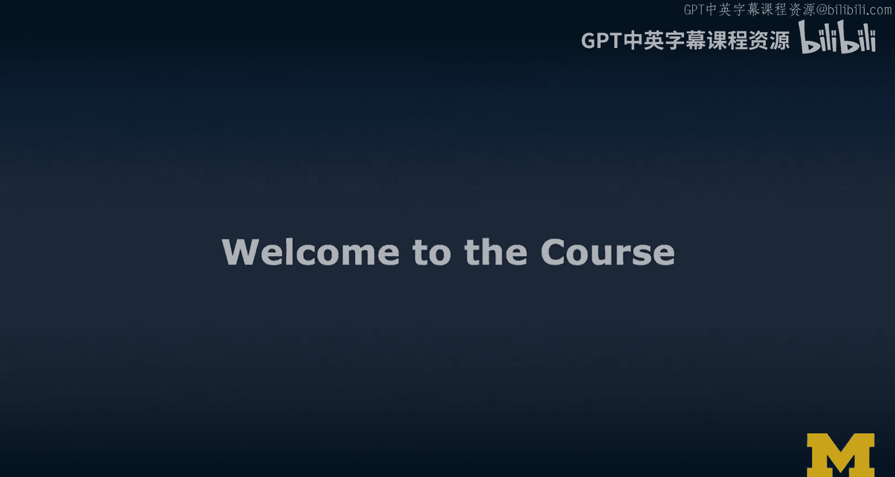
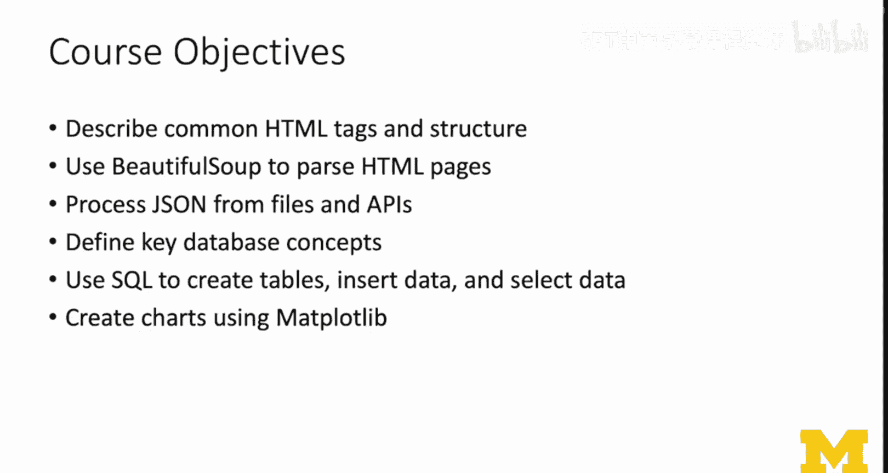
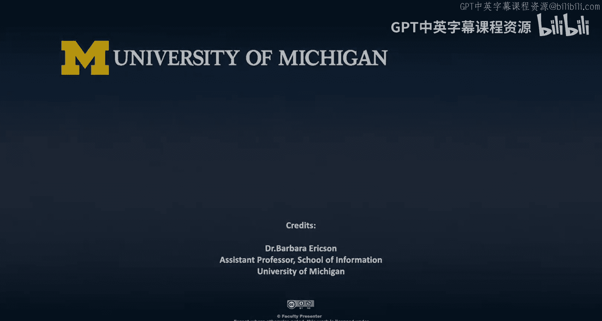

# 密歇根大学《创造性编程（创意、面向对象、debug、QA）｜Creative Coding： Hands-On Python》中英字幕 p134 1_欢迎来到本课程.zh_en -BV1ef421S7Bc_p134-

Welcome to this course， we're going to teach you how to work with data from the web。

 HTML data or API data， how to store that data into databases， how to grab data out of the databases。

 and how to create charts to try to understand your data。

So some of the things we're going to learn is web pages are made of HTML or hypertext Markup language。

 so you're going to learn some of the common tags and how those tags are structured where the relationships between those。

You're going to use beautiful soup to parse HTML pages to get just the pieces you want from an HTML page。

 you'll use JSON or process JSON from both files and APIs。

You'll learn key database concepts and how to use those to create normalized tables and insert data and select data from tables。

 and then you'll create charts using that Plib。

