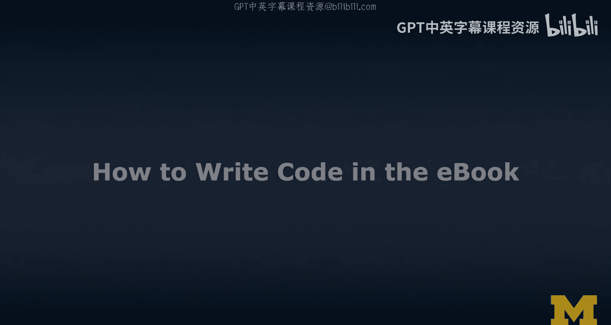
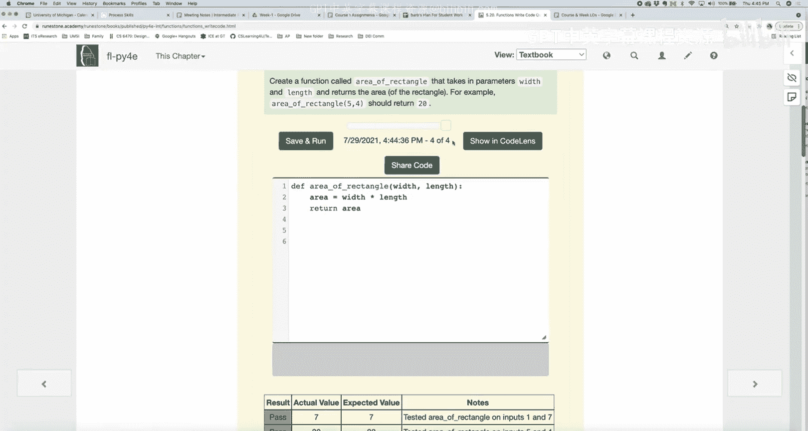

# 密歇根大学《创造性编程（创意、面向对象、debug、QA）｜Creative Coding： Hands-On Python》中英字幕 p139 6_电子书中编写代码的方法.zh_en -BV1ef421S7Bc_p139-

So one of the nice features of using the ebook is you can write code right directly in the ebook。

 so let's see how that's done。So here to create a function called area of rectangle。

 takes some parameters width length， returns the area of the rectangle， for example。

 area of rectangle 5 come4 should return 20， which is  five times 4。

So all I can do here is just simply I might calculate the area equals width times length。

And then maybe if I try to run that， I might see， oh， that I've forgot to actually return anything。

 so I need to return area。And if I run that， I see that that now passes the test cases I could show it in the code lens。

 I could even share the code with somebody else if I'm working in a team and I want them to also have that code。

Also， there's this pencil icon on the top right that lets you pull up a window that you can type Python code as well。

 so if I wasn't sure if the star thing did the right thing。

 I could have just tried five times four print that to see what the result was。

And then I could just close that up when I'm done with it I also want to point out one other thing you should be logged in while you're working if you are you'll notice this slider and so I can actually walk back。

 look back through my code to see what it looked like originally。

 what did it look like the second time I did it or the third time so I actually solve this before and so I can see a history of what happened with my code。

