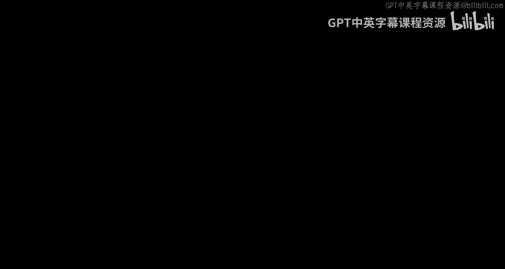
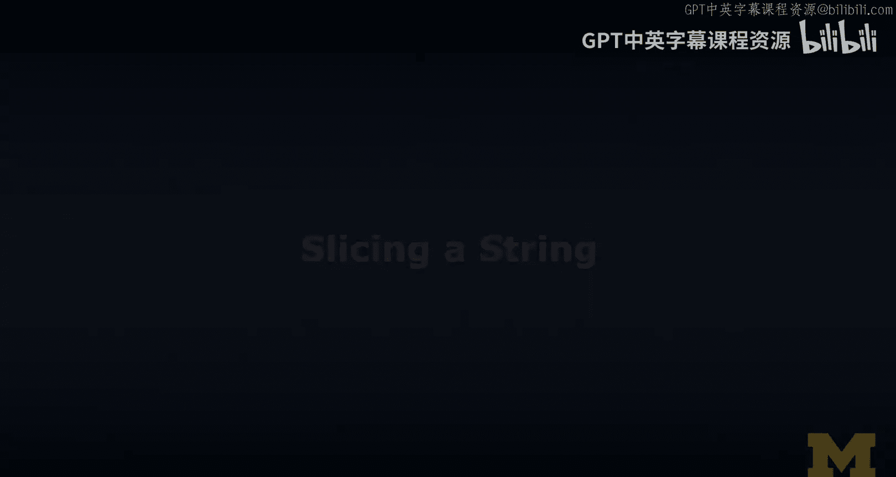
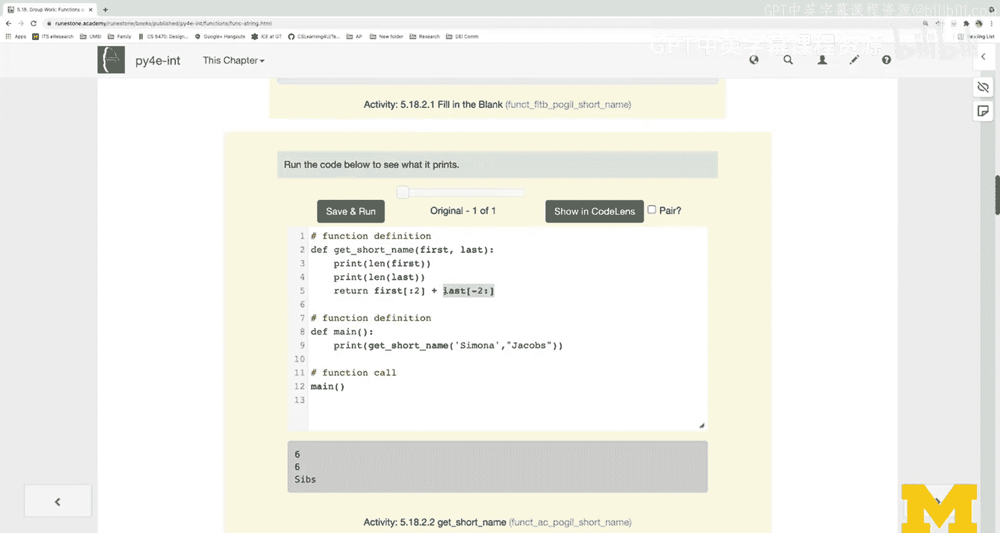
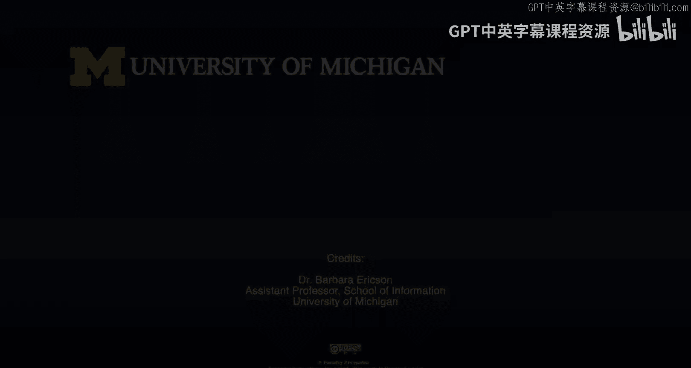
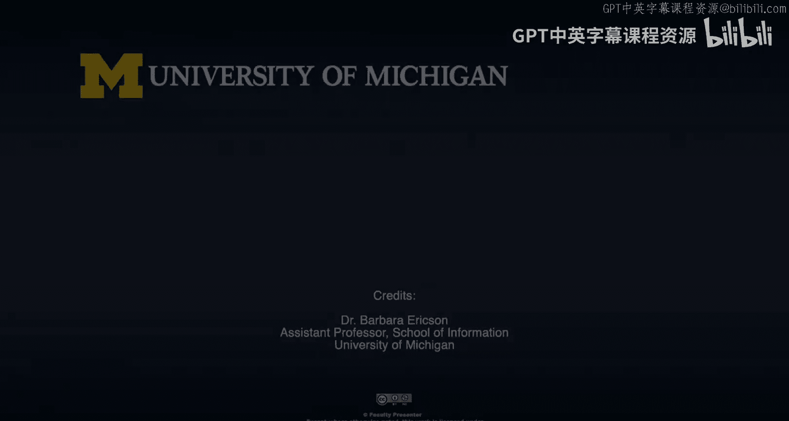

# 密歇根大学《创造性编程（创意、面向对象、debug、QA）｜Creative Coding： Hands-On Python》中英字幕 p14 13_字符串切片技术.zh_en -BV1ef421S7Bc_p14-

So one of the things you can do as strings is get just part of a string or a substr。 And in Python。

 this is called slicing a string。 So even though it sounds like you're changing the string。

 remember that you're actually never changing the string。 It always returns a new string。

 Let's take a look at this code。 What do you think is going to print here。

 So we have a main method that's calling this gi short name that's given a first and last name。

 and then it's returning something with slices here。 It's appending two slices together。

So what do you think this is actually going to print and then let's try it and see。

So what this does is take the first two characters of the first name and the last two characters。

 the last name using the slice。 So if I see a slice like this。

 there's always implicit then that first character or the first。

 the start of the slice would be index 0。 So the beginning of the string。

 So this says start index 0 and it end before you hit index 2。 So just index 0 and 1。

 which are the first two characters。And then the last one here says take starting at negative2。

 which is not the last character， the one before the last character， and then up to the end。

 which is the length of the string。 So one past the length， one past the last index。

 And so we're getting the first two characters and the last two characters。 that's how slicing works。

