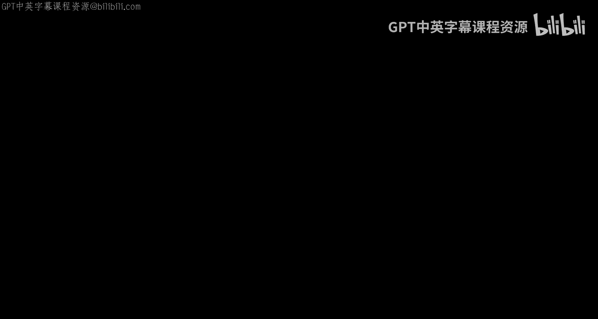
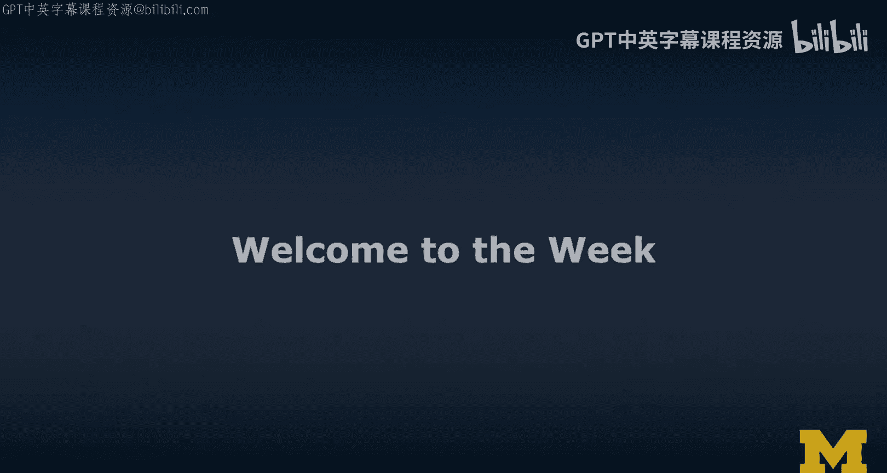
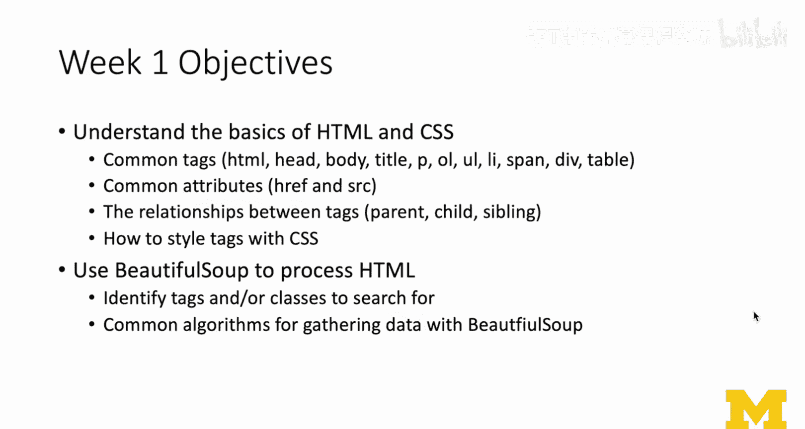
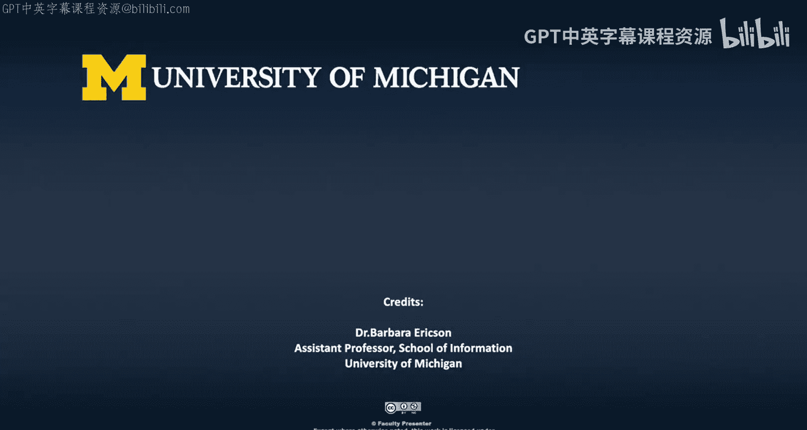

# 密歇根大学《创造性编程（创意、面向对象、debug、QA）｜Creative Coding： Hands-On Python》中英字幕 p141 8_欢迎进入第一周.zh_en -BV1ef421S7Bc_p141-

Alright， so week 1， what are we going to learn。 You're going to learn the basics of hypertext Markup language or Hm and CSS。

 which is cascading style sheets。 This is the language of the web for creating web pages。

 And there's common tags you use？ So you're going to learn some of the common tags like H tags or head or body。

 title， paragraph， ordereded list unordered list， spans， divs， tables， whole bunch of things。

 What are the attributes of those tags。 And how do you work with those attributes。

 What are the relationshipss between tags。 So some tags or parents or children of other tags。

 Some are siblings， And then how do you style tags with C S。

Then you're going to use beautiful soup to process HTML。

 so you'll identify tags or classes to search for。 and then we'll show you some common algorithms for ways of gathering data using beautiful soup。

 so enjoy。😊。

