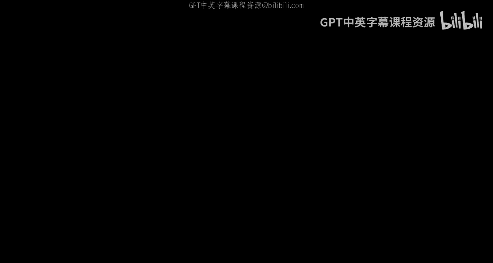
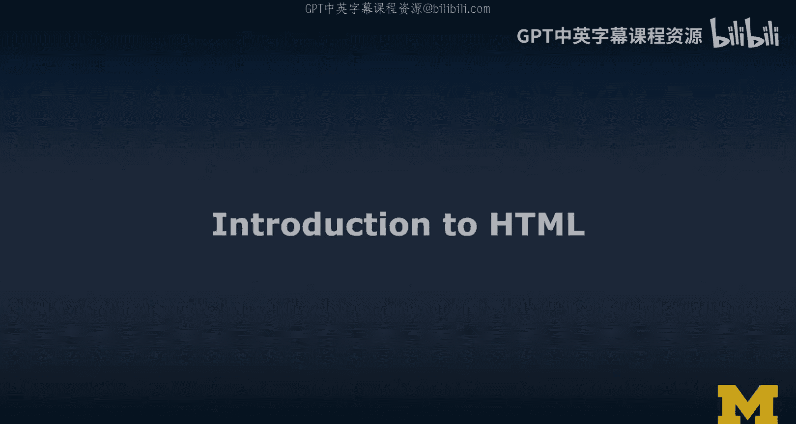
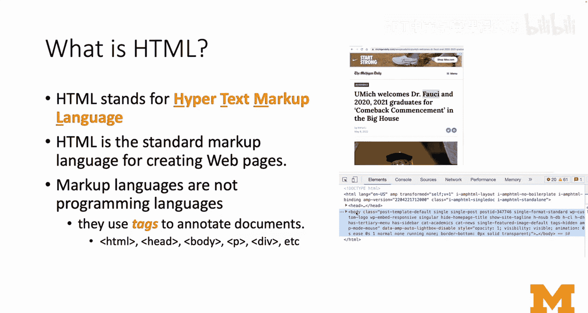
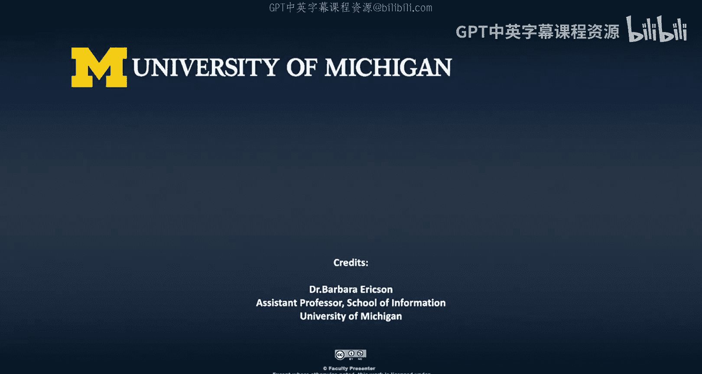

# 密歇根大学《创造性编程（创意、面向对象、debug、QA）｜Creative Coding： Hands-On Python》中英字幕 p142 9_HTML入门.zh_en -BV1ef421S7Bc_p142-

So what is HTML anyway， Well， H stands for hyperpertexts markup language。

 It's not a programming language。 It's a markup language for creating web pages。

 It uses tags in order to specify what are the parts of a document。

 So it starts with like an HTML tag， as you can see here。

 this is a simple page from Michigan's daily newspaper online newspaper of the Michigan Daily。

 and the page starts with a doc type to say this is an HTML document， Then it has HTML tag。

 and then it has a head tag and a closed head tag and an open body tag and there's a closed body tag and a closed HTML tag。

 So HTMLs pairs often of open and closed tags that describe the contents of a document。

