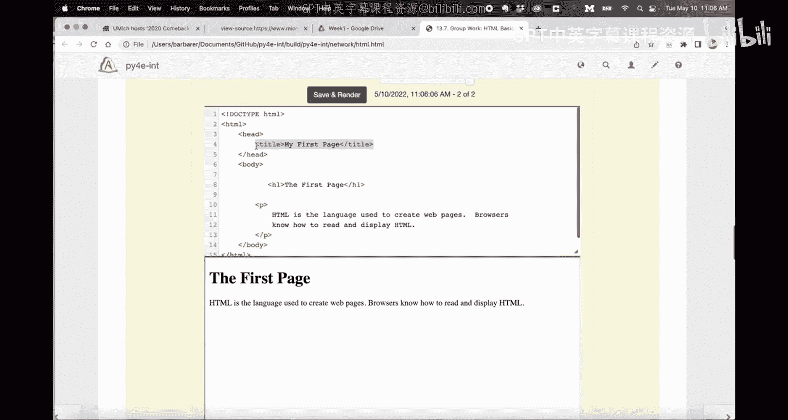
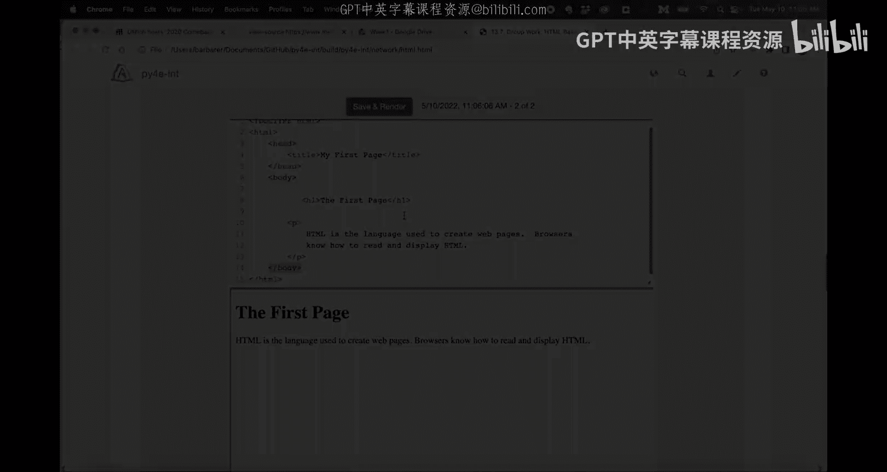

# 密歇根大学《创造性编程（创意、面向对象、debug、QA）｜Creative Coding： Hands-On Python》中英字幕 p143 10_修复HTML代码.zh_en -BV1ef421S7Bc_p143-

So let's try to fix this HTML， so remember that every start tag should have an end tag other than this doc type HTML。

 so we're missing a start HTML。There's the end tag for that。

 and then there's a header that can have a title in it， we have the end tag for title。

 but not the start tag。And then there's a header， but again， just the end tag， not the start tag。

 so we can add H1。And then， we're not closing the。Oh， we haven't closed the header。

 so we should close the header。So all that should be in the header here is the title。

 everything else should be in the body， so we need to open the body as well， start the body。

Then we have a header， then we have a start paragraph， we have the end paragraph。

 we have the end body with the N HTMLtm， and if we render that。

We see that work so remember for every start tag you should have an end tag and you start your document。

 you can start your document with the exclamation doc type you don't have to。

 but you do need the HTML tags and inside the HTML tags you can have a header and a body。

 the header has information that's not displayed like a title or scripts and then the body it contains the things that will be displayed。

