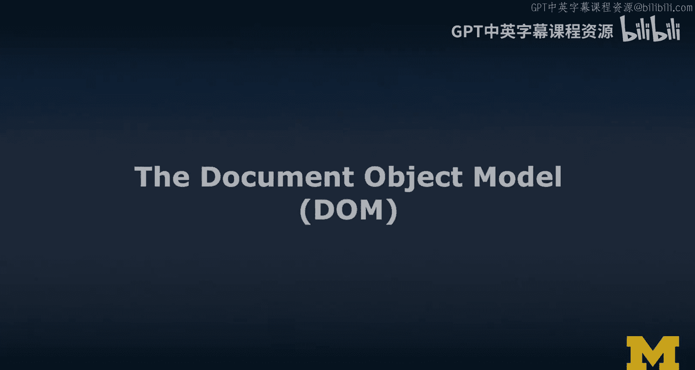
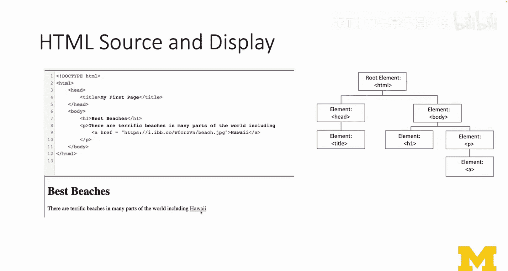

# 密歇根大学《创造性编程（创意、面向对象、debug、QA）｜Creative Coding： Hands-On Python》中英字幕 p144 11_文档对象模型(DOM)解析.zh_en -BV1ef421S7Bc_p144-

So if H 5， there is idea of separation the structure of the document， the H from how it looks。

 which is specified of the cascading style sheets and from how it interacts。

 which is using javascript。 And one key idea is the document object model， which is a tree structure。

 and you can think of it as like an upside down tree。 where the root is at the top。

 And then there's branches going down。 And the H tag is the root element。

 And then in there there are two things to children of that tag head and body。

 And the head is all the things that aren't going to be displayed。

 So there can be a title in the head。 And then the body is everything that's going to be displayed or the structure of the document。

 So there's a header here and a paragraph and then a link tag or an anchor tag inside the paragraph。

 And this is what this looks like。 Here's the HTML page。 you don't have to indent like this。

 but it just makes a structure more obvious。 And this is how you would draw the document object model。

 And we're going to use this document object model when we're parsing H pages to find information。

 And this is how it would actually look when displayed。 It would display the。

er the paragraph and the link， just the text part of the link。

