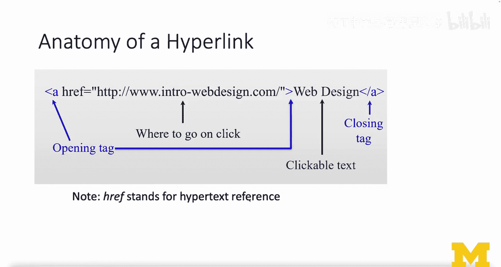

# 密歇根大学《创造性编程（创意、面向对象、debug、QA）｜Creative Coding： Hands-On Python》中英字幕 p145 12_属性详解.zh_en -BV1ef421S7Bc_p145-

So we've been talking about tags and the tags can be in a tree， the document object model。

 and there's children tags and sibling tags。 tags can also have attributes。

 and attributes give additional information that's needed for the tag。

 They're always specified in the start part of the tag。 Of course， with an image tag。

 there is no ending tag。 but it's all here in the start。

 So an image tag has two attributes source and alt。 And then their attribute value pairs。

 So the name of the attribute equals。 And then in quotes the value of the attribute。

 So here the source， where do I find that image， and then the alt is alternative tag for people that。

 for example， are using screen readers。 if they're having vision problems。

Another example is the A or anchor tag or hyperlink tag and it has the opening tag here then it has HR equals and this is where you're going to go if you click on the link then in between the opening tag and the closed tag there's the text that you're actually going be displayed to click on and then there's a class the closing tag and HR stands for hypertext reference so that's what we have here for HR So remember tags can have attributes and aitudes are name and value pairs。

