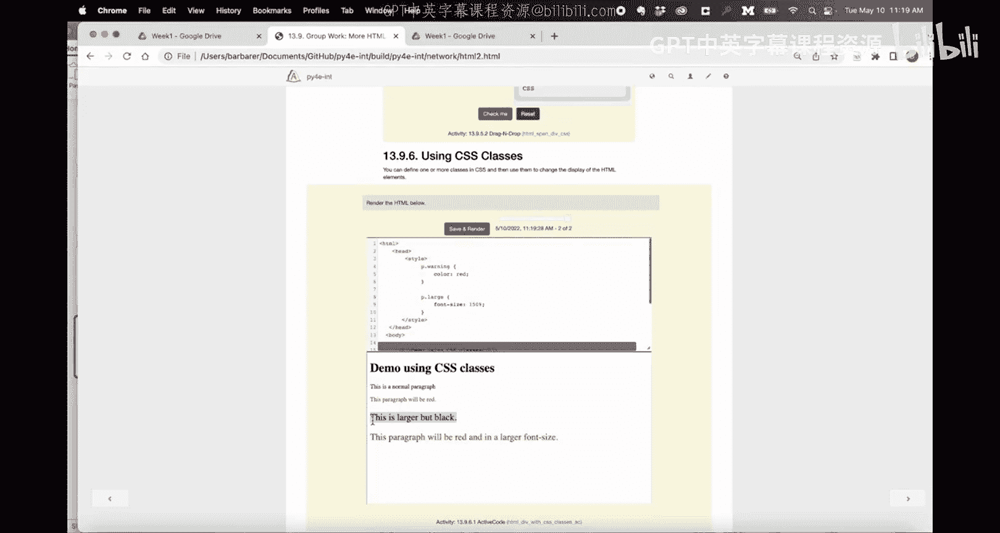

# 密歇根大学《创造性编程（创意、面向对象、debug、QA）｜Creative Coding： Hands-On Python》中英字幕 p146 13_CSS类应用.zh_en -BV1ef421S7Bc_p146-

So let's take a look at one of these examples from the group work。

 So here's an HTML page that has in its header some CSS and CSS stands for cascading style sheets and the idea is that we should separate what the document structure is。

 what's a header what's a paragraph from how it looks and so cascading style sheets or how we specify how things look and then how do we connect those two so we can use different ways one way is you can add a set of classes so I can say on a paragraph。

 create a class warning and when I see that use the color red and when I also create a class large on the paragraph。

Tag And if I see that， use the font size of this。 And then I can combine them。

 So I could say just here's a paragraph with a class just warning。

 Here's a paragraph of class warning and large。 So use both those。 And that's what we see here。

 So if we use paragraph with just warning， we see that it's it's red， And if it's warning and large。

 then it's both red and larger。 If I added another paragraph in here。

 I could add another one that's just larger。Notice that the attribute values are in quotes。

And I'm going to close the paragraph。Most browsers are forgiving so that if you forget closed tags。

 it'll work， but you really should include them all。

 so now you can see that this uses the larger but still black because I didn't add both classes So that's basics of HTML is use HTML to structure your document use CS CSS to specify how that document should look。

