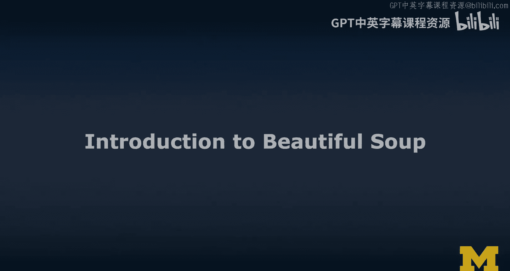
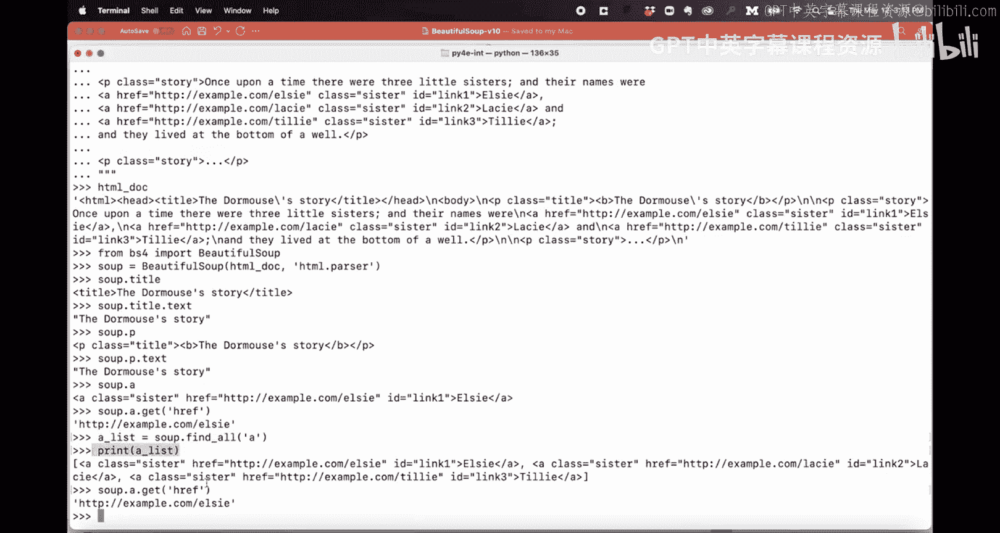
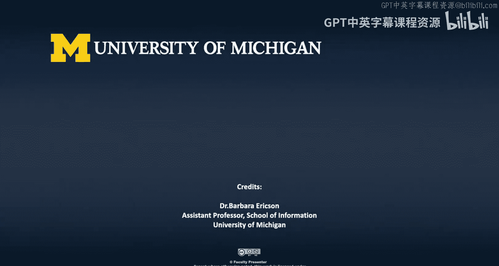

# 密歇根大学《创造性编程（创意、面向对象、debug、QA）｜Creative Coding： Hands-On Python》中英字幕 p147 14_Beautiful Soup入门.zh_en -BV1ef421S7Bc_p147-

So we're going to process HTML pages using beautiful soup and what is beautiful soup？Well。

 it is a Python library that lets us work with either HTML or Xm， which is another format。

 and we can get information from the HTML document by the tags。

 We can also look at the attributes of tags and one of the ways that we use beautiful soup is we have to import the library。

 So from BS4 I beautiful soup and then we can create a soup object on a string that represents an HTML page So create a new beautiful soup object called it soup from a string using the HTML parser and then what that's going to do is give us back this structure So this is an example from the beautiful soup tutorial which is at that URL and there's a fairly simple HTML page it has a HTML course beginning tag and then inside that there's a head in a body inside the head there's a title the text of the title is the dormous's story inside the body。

 there's a couple of paragraphs in the second paragraph there's a bunch of links So let's look at that in more detail。

So in the tutorial， it shows you you can just create a multilined string and name it here。

 HTML underscore document is this multilined string that contains an HTML page。

And then I can import from B S4， importm beautiful soups that I know I can use those names that are defined there。

 I can create a soup object from parsing that string， that HTML doc string， using an HTML parser。

And then I can start asking information about the soup object。 So hey， soup， what's your title。

 And I noticed that the title gives me back both the starting and closing tags as well as the actual text。

 And if I just want the text， I can say， hey， soup do title dot text。

 What's just the text of that and that gives me back the string that is the text。

 I can ask for the first paragraph to saying soup。 P。

 And that's going to give me back again a whole the whole start tag close tag everything in there。

 I could just ask for the text of that and get just again the dormous' story。I can also。

 if I have a link like soup。 a gives me back this link。

 the first link that it finds in the soup and you can see that here。That's the first link， a lease。

So it's here。 and I can get， I can use a dot get， just like I do a dictionary to get the value of one of the attributes。

 So I can say， hey， soup dot a tag， give me the value of your HR attribute。And I get back that。

And I can even use soup dot find doll。 So this is a function of a certain tag。

 And I have to put it in quotes as a string。 So give me all your a tags。

 And I can then print that list， and I could loop through that list and get all the attributes。

 So that's a little bit about how you can use beautiful soup to process an Hmail page。😊。

