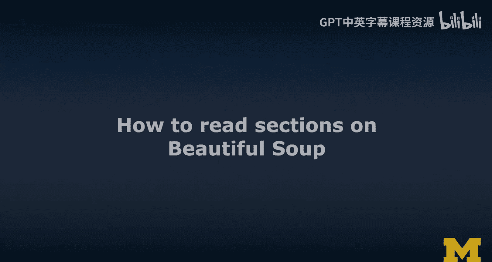
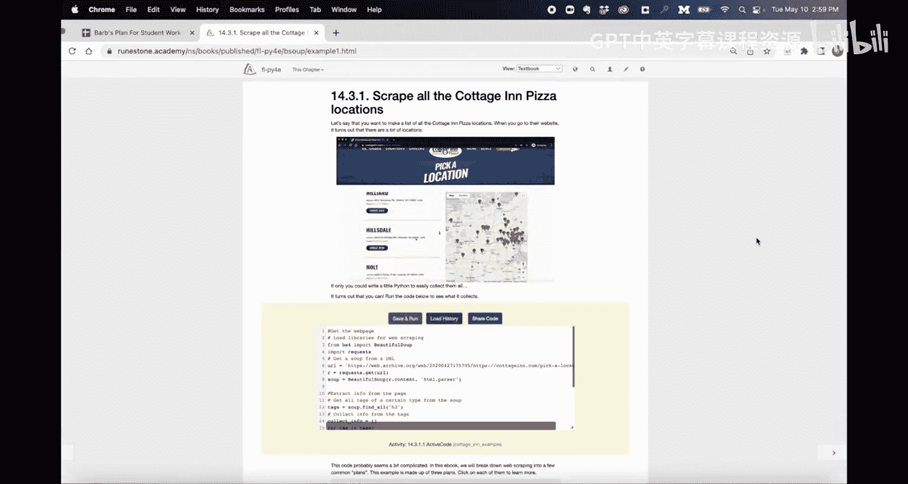
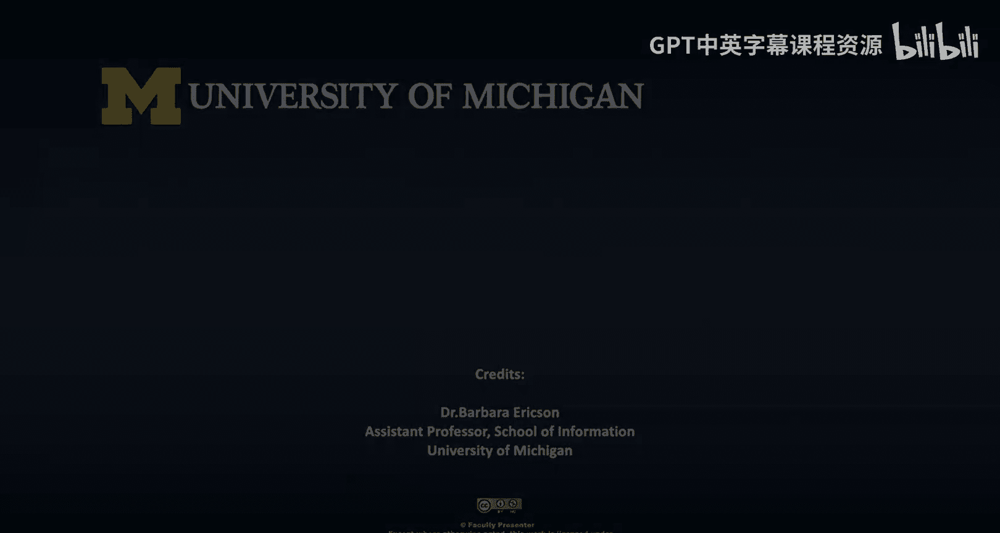

# 密歇根大学《创造性编程（创意、面向对象、debug、QA）｜Creative Coding： Hands-On Python》中英字幕 p148 15_Beautiful Soup章节阅读指南.zh_en -BV1ef421S7Bc_p148-

So I want to show you how I want you to read this section of the ebook。 It's different than normal。

 So if you come to 14 learned web scraping， you can see there's just a little bit of definition of what is web scraping。

 How do this book work。 And then you'll click on this link to go to scrape all the cottage in pizza locations。

 And this shows you how to use beautiful soup to scrape web data or HTML data。

 And it shows you an example code that runs。 But then it also breaks into into different programming plans。

 And what I want you to do is look at each plan， which will take you to a new page。

 And at the end of that page， you can go back to that cottage and example。

 And then you can go to the next plan， do the same thing there， go through the page。

 learn everything that you can on the page， do all the exercises and then go back to that cottage and example。

 So don't just use this next button like you normally would to just step through the chapter。

 So that's how to read this chapter。

