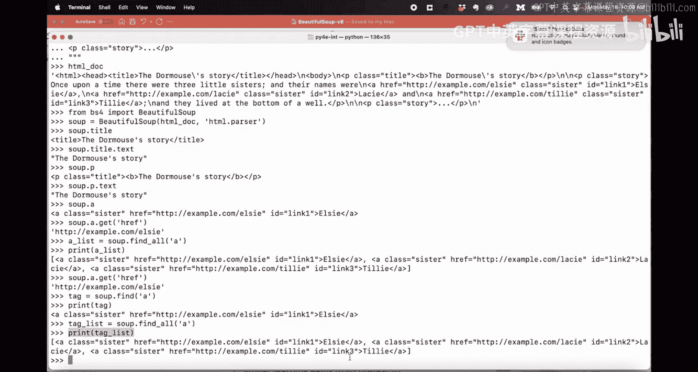

# 密歇根大学《创造性编程（创意、面向对象、debug、QA）｜Creative Coding： Hands-On Python》中英字幕 p149 16_find与find_all方法对比.zh_en -BV1ef421S7Bc_p149-

So there's two things that you're going to use a lot with beautiful soup。

 One is fine to find a particular tag。 The first one of a particular type。

 or find all to get a list of them。 So in this example from the tutorial， we have an HTMLml page。

 It has a body。 Remember that's where all the visible things are in a page has two paragraphs in the second paragraph。

 it has three anchor or link elements。 So if I go to a terminal window where I've already set that up where I have that string defined。

 And here is the string that defines the Hml page。And it has a H tag， then a head tag。

 then a title tag， and then a closed header tag， then a body tag。 First paragraph Do mouse story。

 and the other paragraph with a story in it。 And then a tags in that， as you can see。

 And so if I first say， get the first tag， soupped up find of an a tag。 I get back a tag。

 And I could print that tag。 And that's the entire tag。 So the opening。Tag the attributes。

 the text of the tag， lease and the closing tag。 And then I can also use find all。

 So soup dot find all of a gives me back a if I print that list， I get back a list of tags。

 And that's all the tags in that document。 So find gives me the first， find all gives me all。

