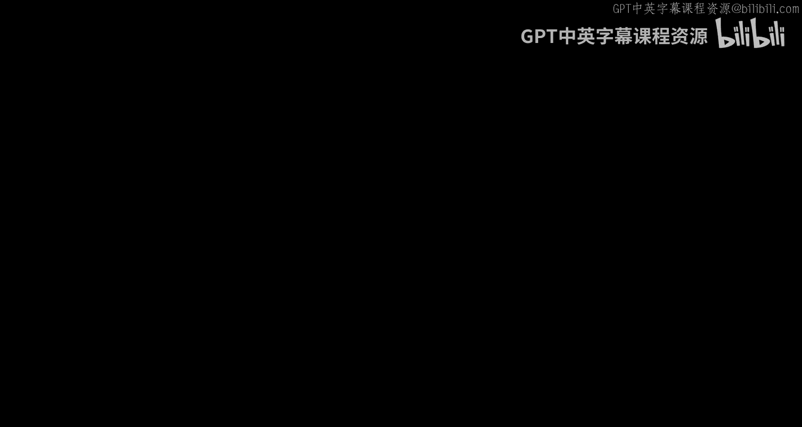
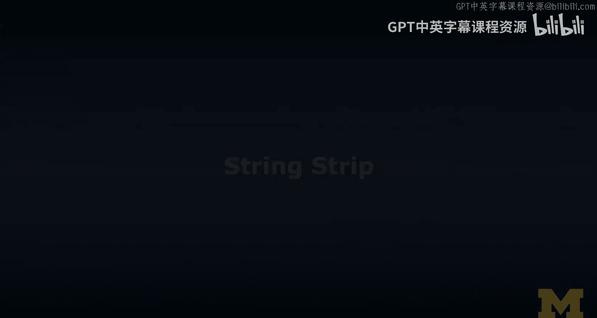
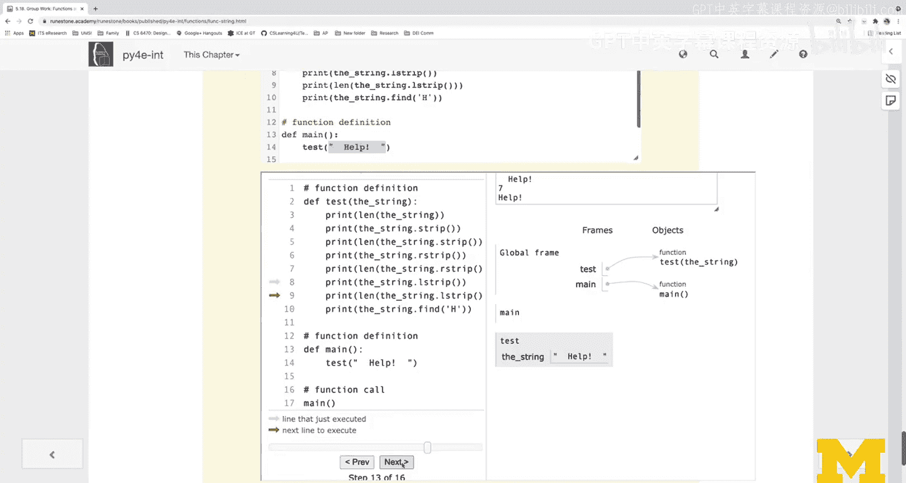
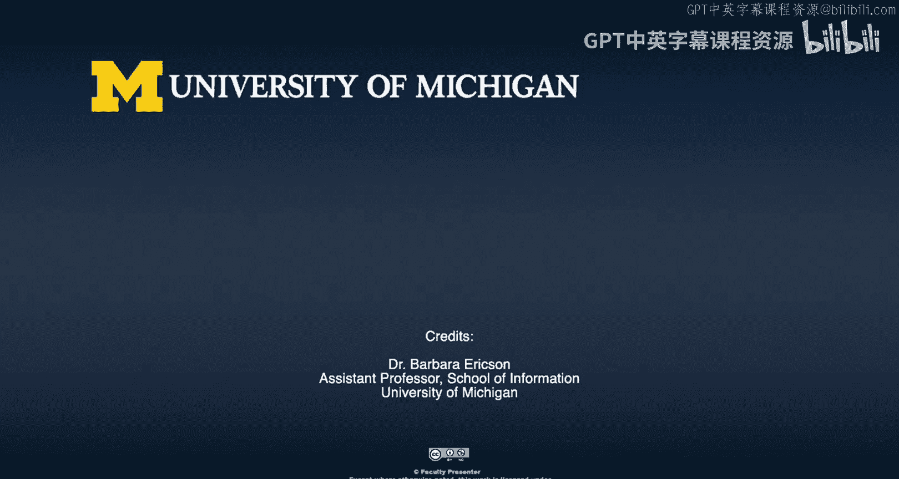

# 密歇根大学《创造性编程（创意、面向对象、debug、QA）｜Creative Coding： Hands-On Python》中英字幕 p15 14_字符清理方法.zh_en -BV1ef421S7Bc_p15-

When you read strings or work with strings， sometimes there's extra stuff at the beginning or end of the string or even both that you want to get rid of。

 And that's where the strip methods come into handy。

 And so what's the difference between our stripip， L stripip and strip。 Let's take a look。

So here's some code where we're going to take in a string and notice that this string has some extra spacing around the actual characters。

 and we're going to print the length of the string。 And then what's the value when I strip it again。

 the length of the string， What's the value when I our strip it。

 And then what's the length of the string， and then what's happens when I L strip it。

 So let's look at it in code lens where we can step through what happens。 So remember in code lens。

 you can just click the next button to walk through。 So we first define the function。

 And then we define the main， Then we call the mains， and now we'll go back to the main。

 We'll test call the test method passing in the string with extra space around the help。

Once we get here to this function， the test function。

 now we're going to print the length of the string。

 so the length of the string we can see the string here is nine。And if I strip the string。

 so we're going to print what happens once I've stripped the string。

 what I get is help exclamation with no extra space around it。

So what's the length of once that' stripped， The length is5 because we've gotten rid of the extra spacing before and after。

 So strip gets rid of spacing， both before and after， including like new lines or tabs even。

 So now let's try R strip。 What does that do。 So we'll print what happens when I R strip。

 notice it still has the extra spacing on the left。

 So R strip just removes the extra spa on the right。 And if I print the length。

 you'll see that it's larger than when I stripped it。 So it's seven characters。

 So I still have some of those extra spaces。 and L strip is the opposite。

 it removes the characters on the left。 but leaves the ones on the right。

 So when I print the length of that， I see it's also 7。 So strip removes both left and right。

 So both L strip gets on the left， R strip gets on the right。 So remind remember that。

