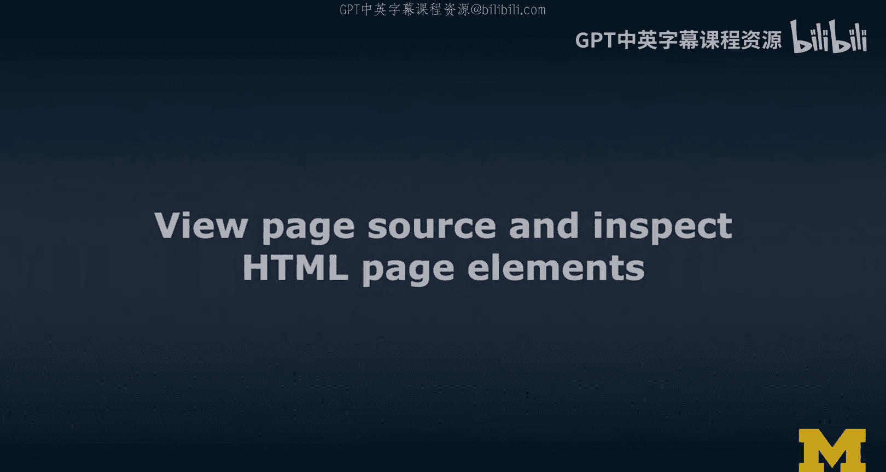
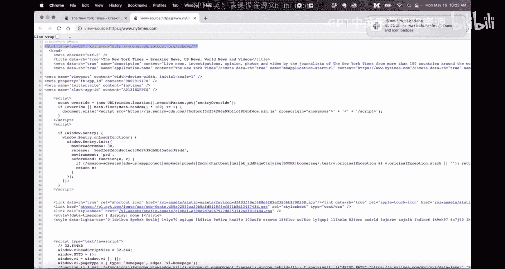
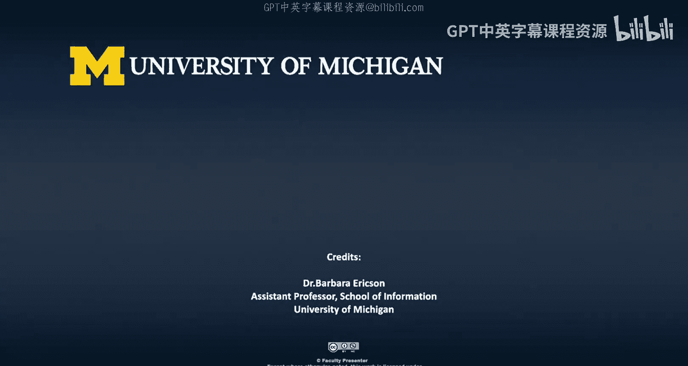

# 密歇根大学《创造性编程（创意、面向对象、debug、QA）｜Creative Coding： Hands-On Python》中英字幕 p150 17_查看页面源码与审查元素.zh_en -BV1ef421S7Bc_p150-

So how do we find particular things in an actual HTML page。

 they can be a lot more complicated than the things we've been looking at so far。

 One of the things you can do is look at this view the page source to see what actually is going on here。

 And here's a page like the New York Times， which is a lot more complicated than the things we've been doing that are very simple web pages。

 So if we want to find a particular thing and might be hard to actually find that in here。

 So I'm looking for the world link。 and there's lots of world in here。 So may difficult to find。

 So you can view the page source just to see。 And I can see there's the H tag。

 there's the header tag。 So you can see the HTML。 And if you can find it in the HTML you can find it with beautiful soup。

 there are also a dynamic web pages where it is generated from Scripps。

 And so if you can't find it in the page source， you're not going be able to use beautiful soup to find it。

We can also inspect an element in a page which is very useful so here I'm control right clicking on a Windows machine。

 I could just right click， I can inspect that element and that shows me that that's an a tag that has a class of CSS1 and there's the world section so if I wanted to get a list for each of these little headers what was the URL。

 I could do that by looking for all the A tags with this particular class。

