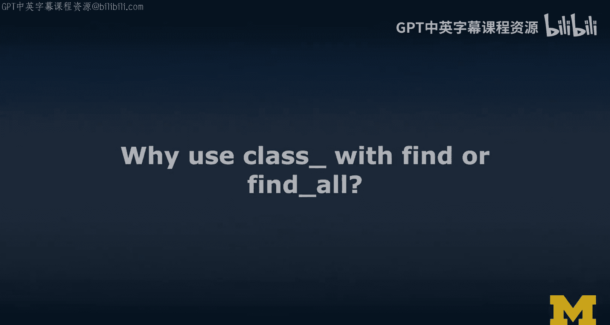
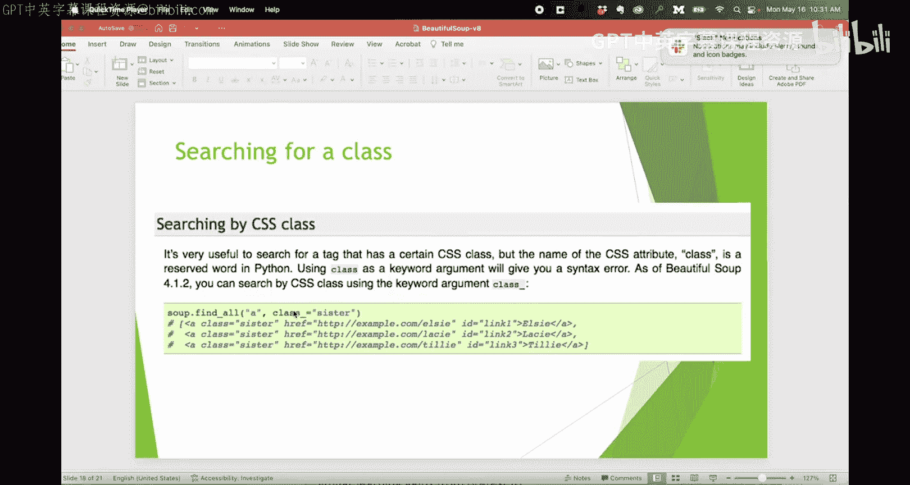
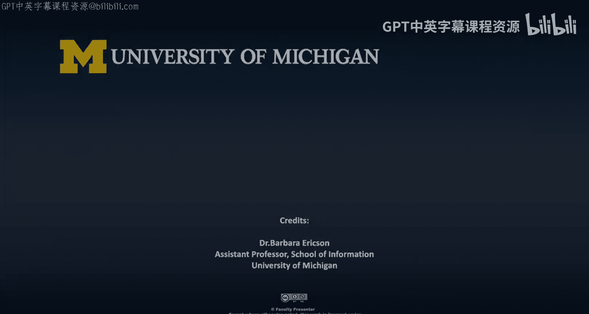

# 密歇根大学《创造性编程（创意、面向对象、debug、QA）｜Creative Coding： Hands-On Python》中英字幕 p151 18_为何在查找时使用类属性.zh_en -BV1ef421S7Bc_p151-

So you may have noticed that we're using when we're trying to find something with a class。

 a CSS class that we're using class underscore and why is that Well that's because class is already a reserved keyword。

 so we can't just use class here， So we use class underscore instead If we're using ID。

 we can just use ID that's fine when you're looking for things with CSS and what's nice about the class thing。

 especially in a very complicated HTML page is it narrows down what we're looking for。

 I may not want all anchor tags， but just those particular class。

