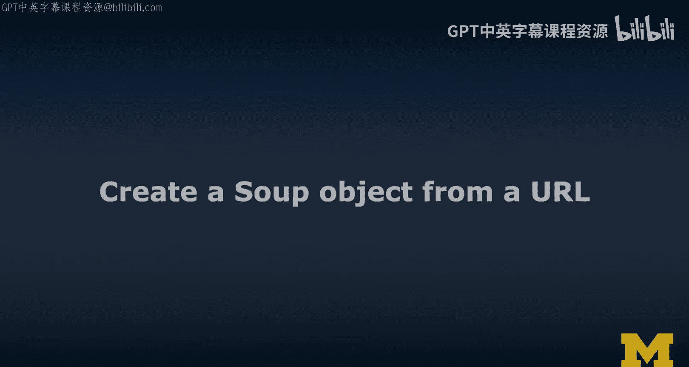
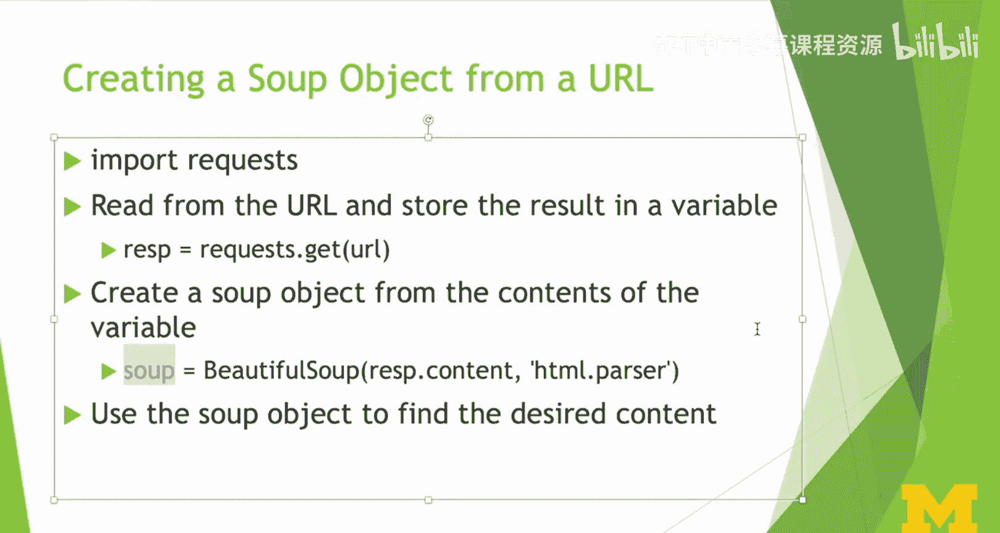

# 密歇根大学《创造性编程（创意、面向对象、debug、QA）｜Creative Coding： Hands-On Python》中英字幕 p152 19_从URL创建Soup对象.zh_en -BV1ef421S7Bc_p152-

You can we've been reading HTML from a string。 So if you've read from a file， for example。

 if you've saved HTML to a file， you can read it all into a string and then process it。

 but you can also get the data directly from a URL。 How do you do that。

 you can import the request module or library and then you can read directly from the URL using request get from the URL that will return a response object and you can check that response object。

 there's a code to see if that's okay， So 200 means okay404 may not found and but that sort of optional if you want to assume that it work。

 you can just directly create a soup object from the content of that response and parse it using an HTML parsor。

 So notice you're creating a beautiful soup object and here you named it soup but you can name it anything and that's going to give you that root of that document。

 and then you can use the soup object to find the desired content。

