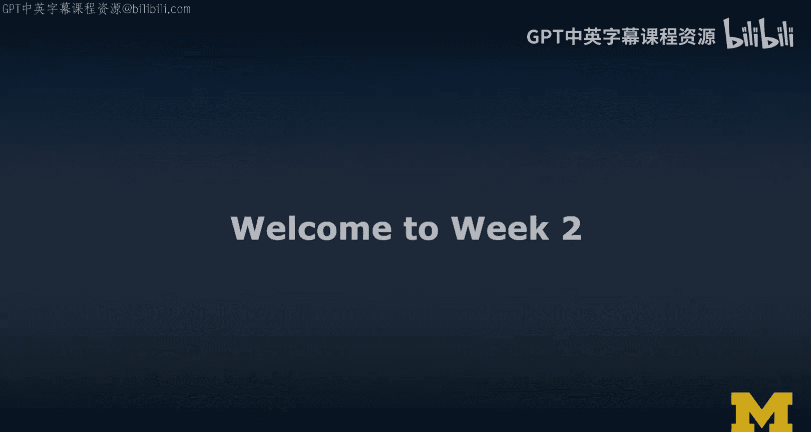
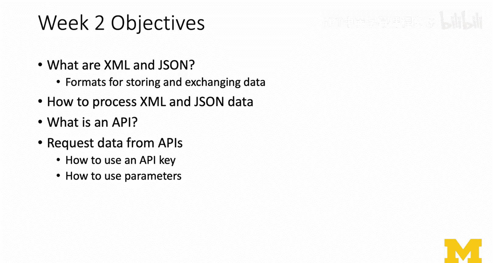
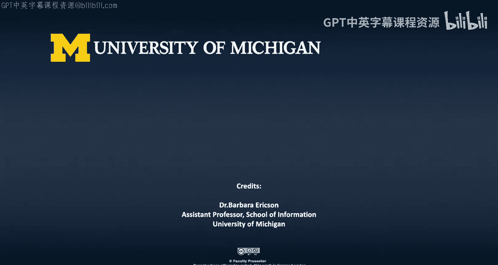

# 密歇根大学《创造性编程（创意、面向对象、debug、QA）｜Creative Coding： Hands-On Python》中英字幕 p153 20_欢迎进入第二周.zh_en -BV1ef421S7Bc_p153-

Welcome to Week two this week you're going to learn how to work with XML and JSON these are two formats that you can use to exchange data。

 you're also going to process XML and JSON and then you're going to learn what an API is and that's the way that you can request data it's an application programming interface that one application request data from another and particularly we'll use request。

get from HP to do an Hp request to get data。It'sFrom APIs。

 and you're going to learn how to request data from APIs， how to use an API key if that's required。

 and how to use parameters on your request。

