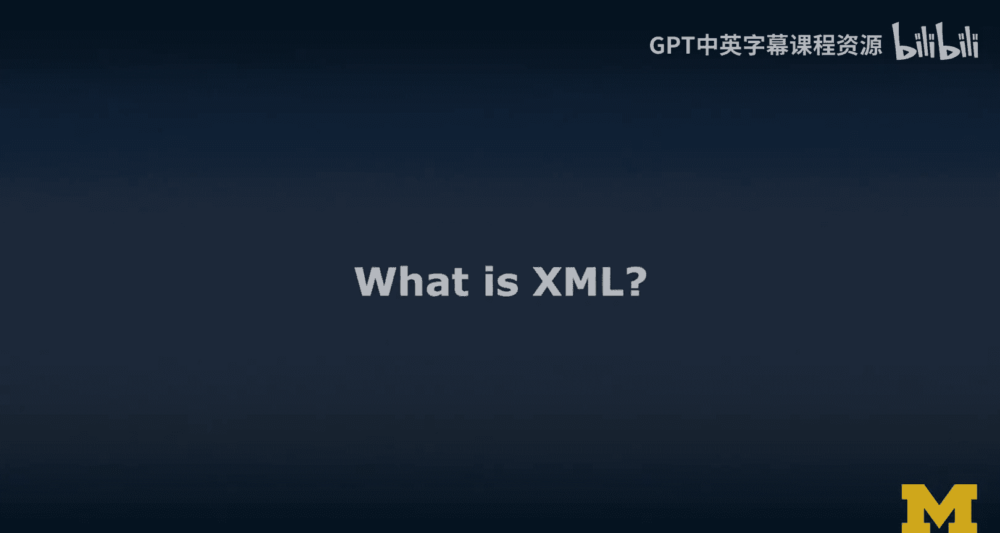
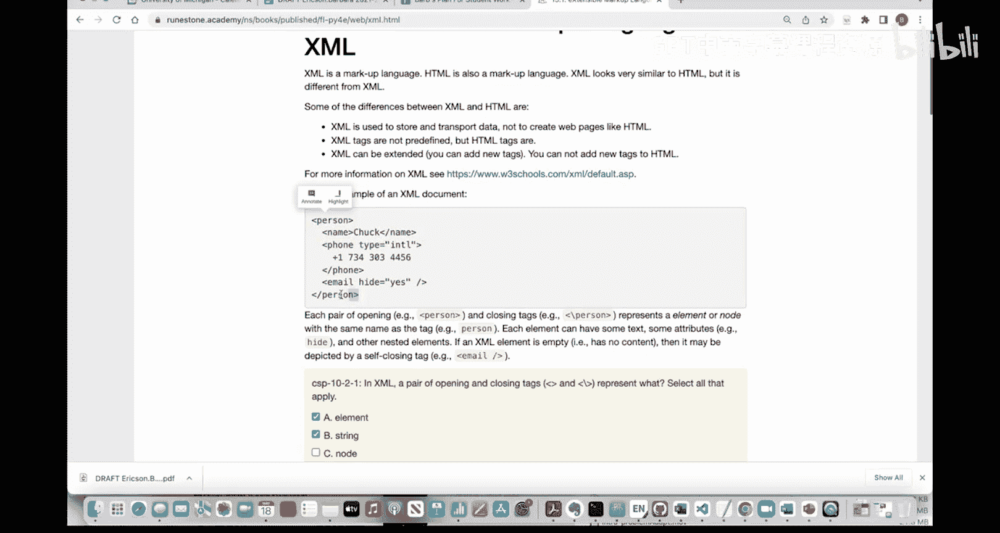
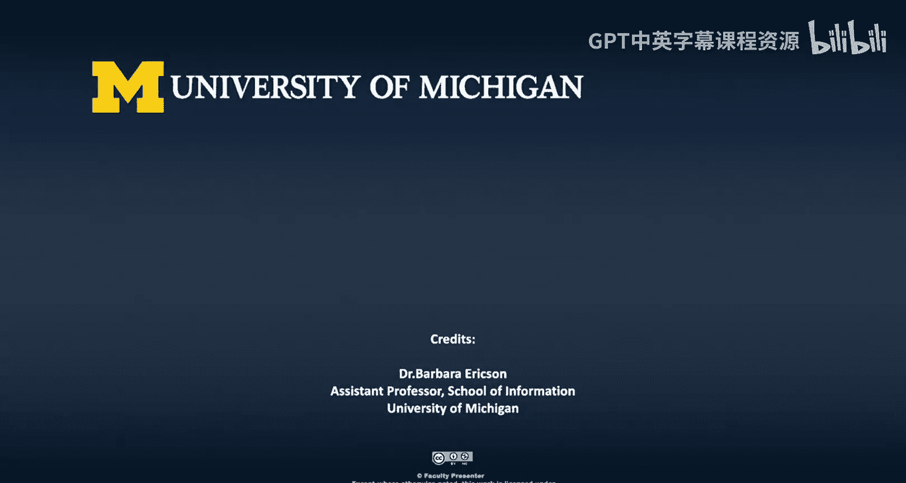
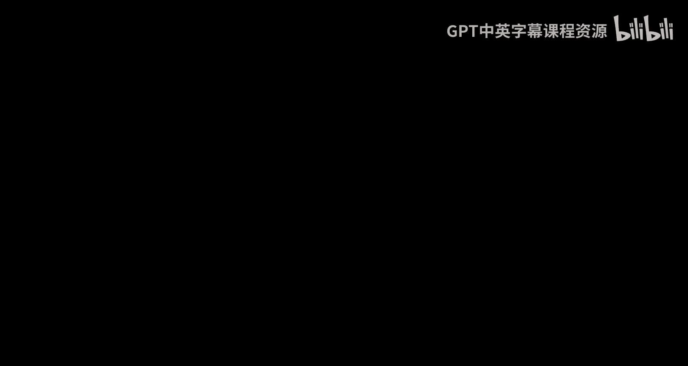

# 密歇根大学《创造性编程（创意、面向对象、debug、QA）｜Creative Coding： Hands-On Python》中英字幕 p154 21_XML概念解析.zh_en -BV1ef421S7Bc_p154-

So we're going to talk about XML and what is XML Well XML stands for extensible markup language。

 extensible means that you can add to it。It's like HTML in some way。 So here's an Xml example。

 So as you can see， it's a markup language， and it uses the same less than greater than signs like HTML does。

 and it has both start tags and end tags and tags can be nested。

 So there's tags inside this person tag with information about a person。

 So it's basically another format that we can use to both store and exchange data。

