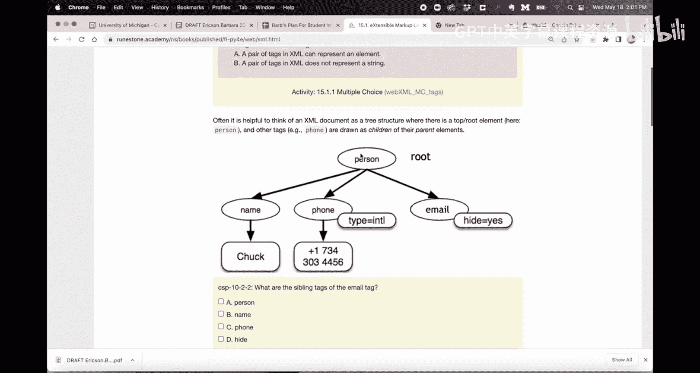
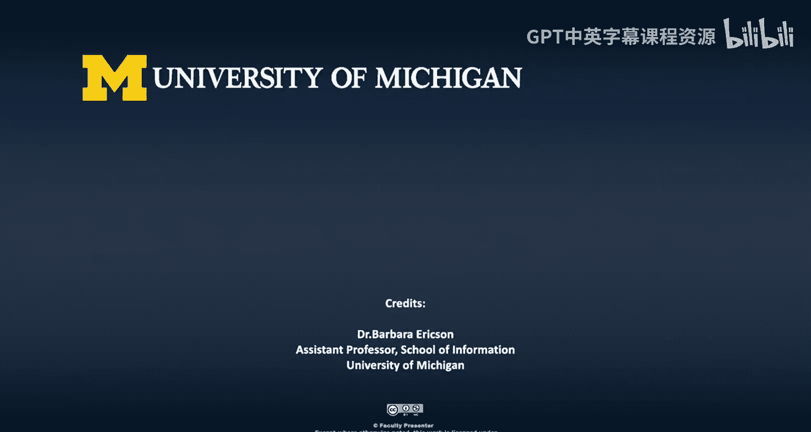

# 密歇根大学《创造性编程（创意、面向对象、debug、QA）｜Creative Coding： Hands-On Python》中英字幕 p155 22_XML术语详解.zh_en -BV1ef421S7Bc_p155-

So let's look at this a little bit more in detail， so this is an example of XML XML document。

And we have both start tags and N tags， as we've seen before。 We also have self closing tags。

 So if a tag has no content， there's nothing between the start tag and the N tag。

 then you can just self close it with this slash bracket。

 So this data can also be represented as a tree structure where the person node here element is the root。

 and then each of the data elements are children of that root。 So that's what this would look like。

 The person node is the root， and it has children elements of name， phone and email。

 and the name element has text of checkuck and the phone element has a text of the phone number。

 It also has an attribute of type with a value of international or INtl。

 and the email element has just an attribute of hide with a value of yes。

So that's how you can handle both the hierarchical structure， parent and child。

 So a phone's parent is person， the person's children or name， phone and email。

 So that's a little bit about the terminology。

