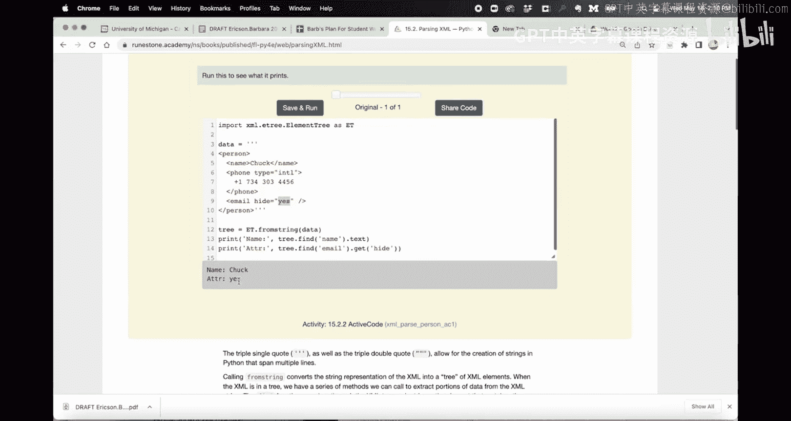

# 密歇根大学《创造性编程（创意、面向对象、debug、QA）｜Creative Coding： Hands-On Python》中英字幕 p156 23_XML解析技术.zh_en -BV1ef421S7Bc_p156-

So let's look at how we par Xml and we can use just like with beautiful soup。

 we can use another library。 We can import from Xml。etree。 elementementary as ett。

 meaning we can just use this name when referring to this module or library。

 So here we just use the short name ET。 Then we create a variable data。

 and we set it equal to the result of this triple quoted string。

 and that's how we specify multilined strings in Python。 and we have the Xml inside that string。

 So we create a tree object by parsings， we say Et dot from string of this data。

 So it's going to read the string data， recreate a tree structure and hand it back to us。

 with the top node， the root node， this person node as the first thing。😊。

And then we can start using find to find information that are children of that tag。 So person tag。

 what are the children。 We have name， we have phone， we have email。

 So we're looking for the name tag。 And then from that， we're getting would get back this。

 And then from that， we're just getting the text， which would do just this piece。

 And then for another piece。 we're saying find the email tag， which would be this one。

 And then get the attribute hides value。 So here's the hide attribute of the email tag。

 And it's going to get this Yes。 And it's going to print it concatenated with this name colon。

 So we see name colon Chuck attribute colon， yes。

