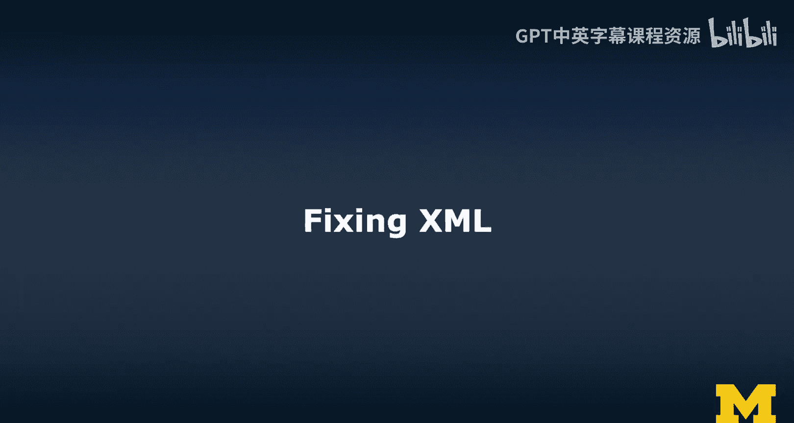
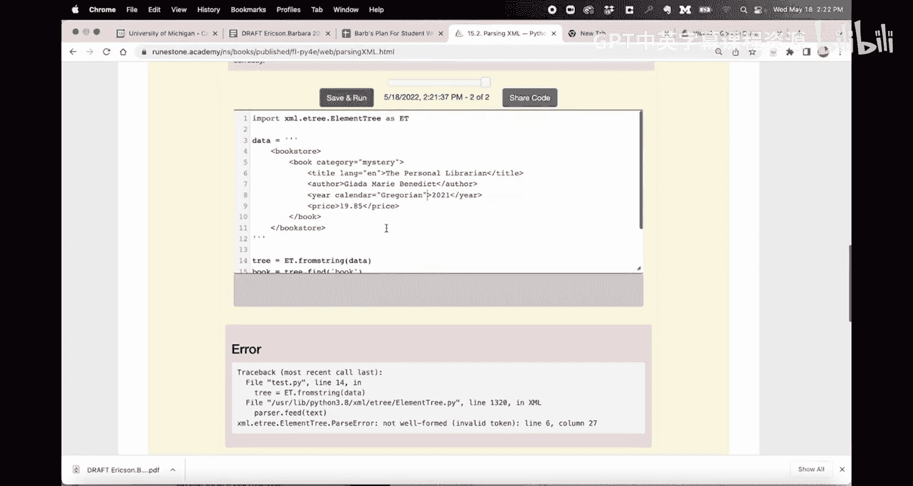

# 密歇根大学《创造性编程（创意、面向对象、debug、QA）｜Creative Coding： Hands-On Python》中英字幕 p157 24_修复XML文档.zh_en -BV1ef421S7Bc_p157-

Let's look at fixing one of these problems。 So looking at this one， particularly。If we try to run it。

 we'll see we're going to get some errors。And we see an error line 14， the Xml invalid token line 6。

So line 6， there's something wrong。 Oh， we're missing an end。For our title。

 we have our beginning for our title， we don't have our end。

And it's useful to just check all of these， a bookstore， there's the end of bookstore book。

 this is on the wrong side that should be in the front。We have a beginning tagga for egg。 Oh。

 we're missing the end for author。 We have beginning for year。 We have the end for year。

 We have price。 We have the end for price。 So are there other errors。

 There still are some other errors。 What else do we have wrong here。It also says Line 6 parser feed。

 so beginning book store book category， you can check that all of the attribute values are in double quotes or single quotes we're missing that here in Gregorian。

So that's another thing that'll cause it to fail。

And so now it's working。 So that's how we can fix that。 So check that every open tag。

 make sure you have an open tag and that you have that a has a matching closed tag and make sure that there every attribute value has either single or double quotes matching around it。

