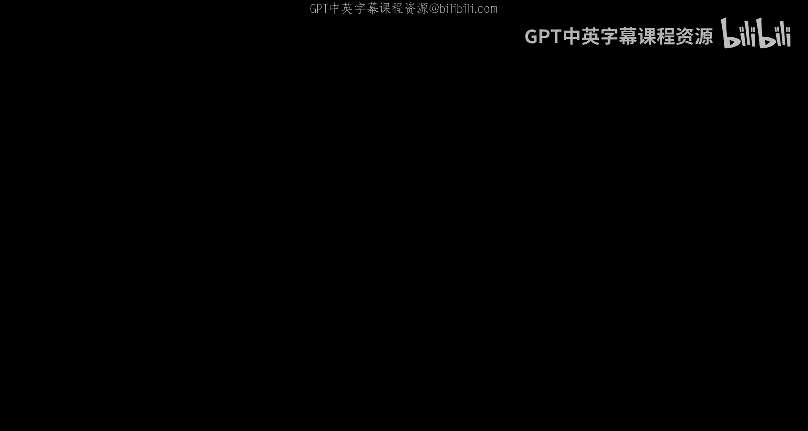
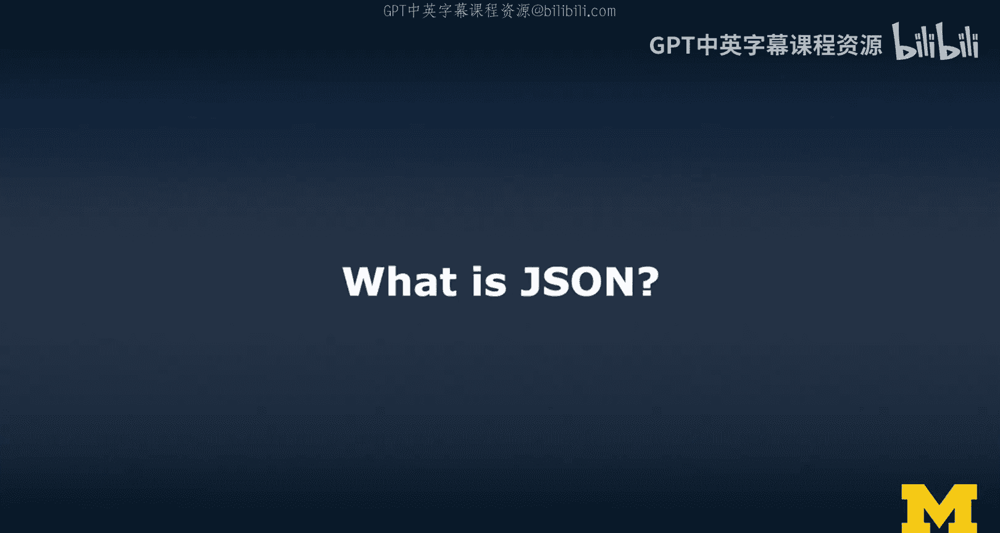
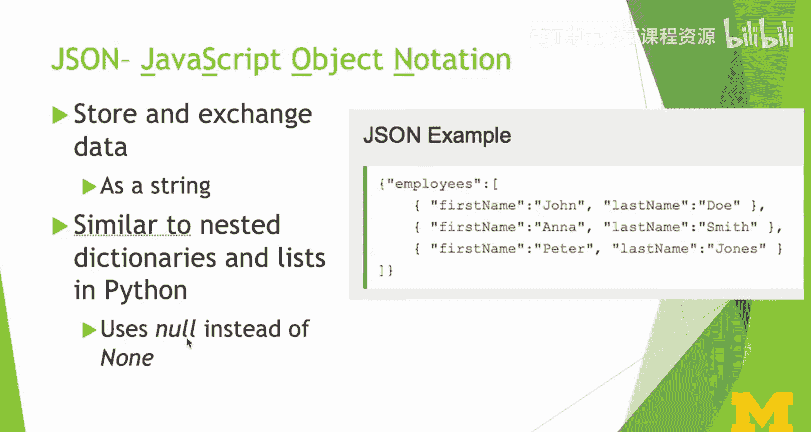
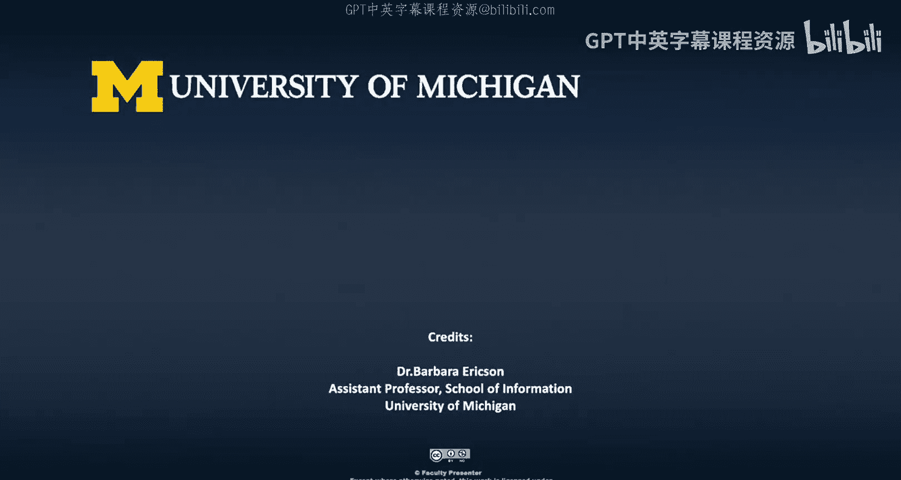
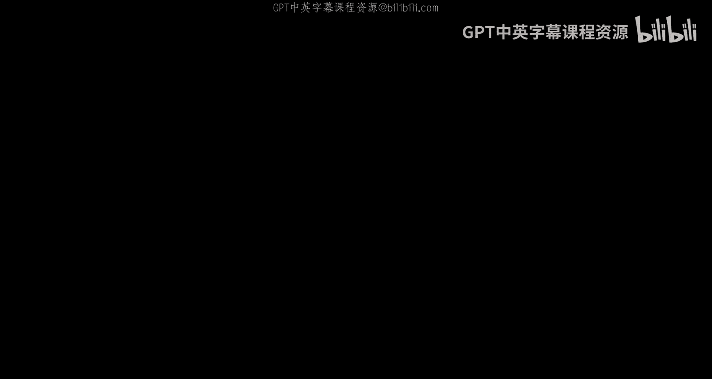

# 密歇根大学《创造性编程（创意、面向对象、debug、QA）｜Creative Coding： Hands-On Python》中英字幕 p158 25_JSON基础介绍.zh_en -BV1ef421S7Bc_p158-

What is Json， JS stands for a JavaScriptscript object notation。

 and it's a way we can store and exchange data， particularlyicular we can get data from web servers as a string。

 And what that string represents， though， is nested dictionaries and lists similar to what we see in Python。

 So for this example， we see we have a dictionary that has a key of employees and the value of a list of dictionaries。

 And then each inter dictionary has a first name and a last name。

So very similar to Python except that it uses null instead of none to indicate no value。

