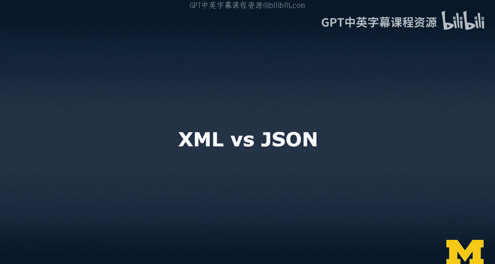
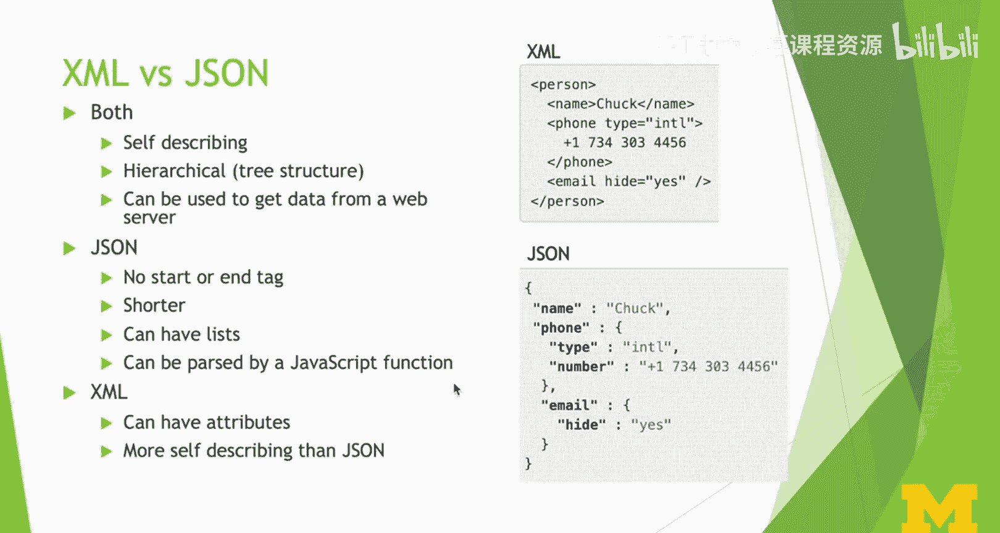

# 密歇根大学《创造性编程（创意、面向对象、debug、QA）｜Creative Coding： Hands-On Python》中英字幕 p159 26_XML与JSON对比.zh_en -BV1ef421S7Bc_p159-

So let's compare Xml and Json。 So here's an example in Xml。

 So remember it looks a lot like HTMLl that it's a markup language using the angle brackets。

 You can have things like attributes in opening tags。 you can have self closing tags。

 So and then Json is this la nested structures of dictionaries and lists。

 So here's dictionary that has name and a phone and then a phone has an inter dictionary of type and number。

 and it has another outer dictionary of email and hide。 So you can have these nested structures。

 They're both sort of selfdecrib。 They both kind of explain what kind of things they are。

 though Xl is better at self describingcrib than Json， you get more detail about this is the phone。

 This is the email。Though you have that as well as with the keys here。Both are hierarchical。

 both have this tree structure， both could be used to get data from a web server。

 but JSON doesn't have this start and end tag， you can see this person end person。

 you don't have that。You can see that the JSON can be shorter， doesn't always have to be。

 it can have list to， it can be parsed by a JavaScript function， whereas XML can have attributes。

 but you can turn those into dictionary values in JSON。

And it's more self describing than JSON In general。

 most people are using JSON more than XML these days for transmitting data。

 people are using XML for things like word processors or to create ebooks to be more self describing。

