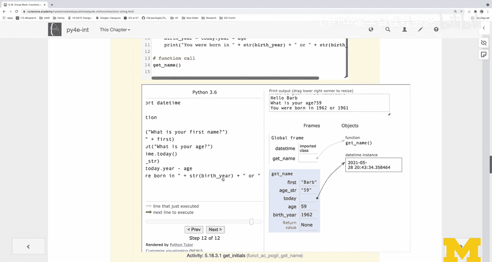

# 密歇根大学《创造性编程（创意、面向对象、debug、QA）｜Creative Coding： Hands-On Python》中英字幕 p16 15_类型转换实践.zh_en -BV1ef421S7Bc_p16-

So as we've talked about before， there are different kinds of data in a computer and it represents it in different ways。

 So if I have numbers， those are represented in one way in the computer and then characters like letter A。

 B C， those are represented in a different way and the computer needs to know。

 are we talking about a string or we talking about a number here？

And so when you're concatenating strings together， sort of like when you're printing values out of variables。

 that's one of the things you have to keep in mind is that you can't put two things together that are different types。

 So if I have a string and I want to add a number I've got to convert it from a number to a string。

 And then conversely， I can't do calculations on something that's a string。

 I have to convert it to a number。 So let's take a look an example of that。

So here's some code where let's walk through it with a code lens。

 so we're importing a date time function that's something that lets us get what's the date today。

 then we're defining the function get name， then we're calling that function get name So here we're going to go into that function get name we're going to print hey input。

 what's your first name。And I see that show up down here， and I'll go ahead and say barb。Submit that。

 and that's going to print hello plus my first name。 So I see Ho Barb。 and that it says， okay。

 what's your age。Here and it's waiting for me to enter that， so I'm 59， so I'll submit that。

And then it's going to say okay， well what's today's date so you saw that here and notice that the age string right here is a string。

' it's got this double quotes around it to show it's a string， so it's not a number currently。

So when we calculate the date time for today and now we want to do some calculation of what year was I born in。

 then we're going to take the age and convert it from a string to an integer。

 So this int peren pern with a string name is going to convert it from a string to an integer。

 When I do that， I see now that age is 59， it's now an integer。

 And now when I go ahead and going to calculate my birth here， I can do that。

 So today's year minus my age gives you 1962， which is not quite right。 I'm actually was born in 61。

 but my birthday hasn't occurred yet this year。So then it says you were born in either 1962 or 1961。

 but notice I had to convert back the birth year from an integer to a string。

 So remember when you're working with input， anytime you input anything， it's going to be a string。

 you might have to convert it using that int function to convert it to an integer and then when you want to concatenate strings。

 you need to convert to a string using that string function。

