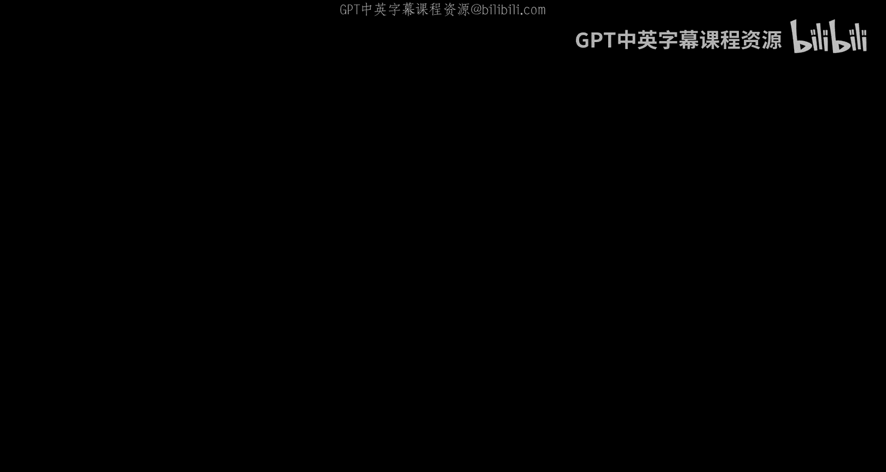
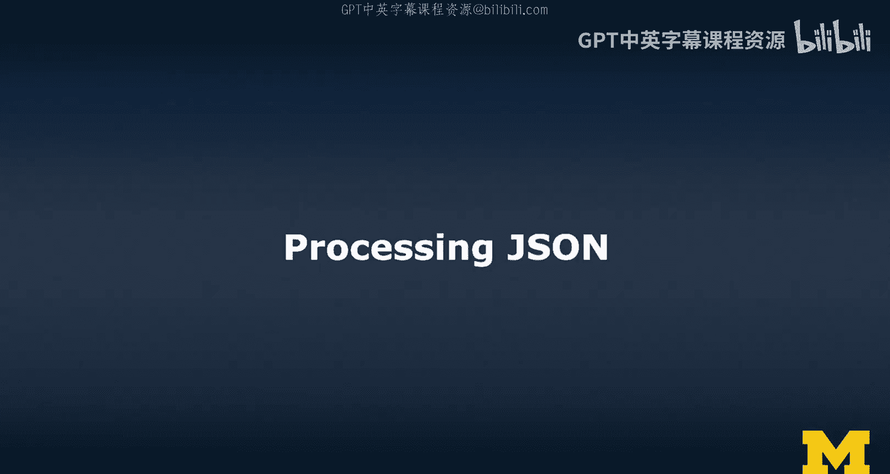
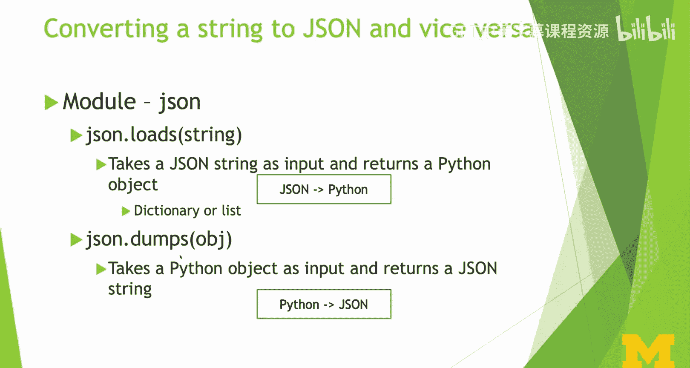
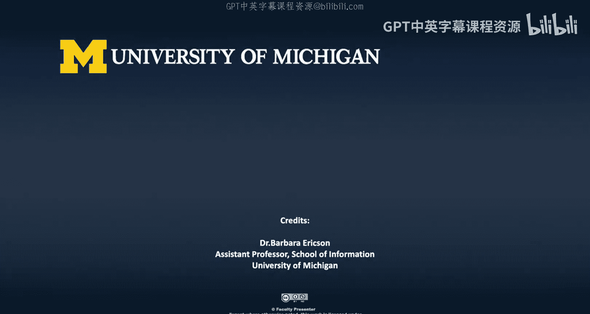

# 密歇根大学《创造性编程（创意、面向对象、debug、QA）｜Creative Coding： Hands-On Python》中英字幕 p160 27_JSON数据处理.zh_en -BV1ef421S7Bc_p160-

So how do we convert using JSON between Python objects and strings We have to import the JSsonN module that's a library that lets us process JSON。

 and then we can take a string and we can convert it to a Python object either a list or a dictionary using JSsonN do loads given the string thatll return a Python either list or dictionary so we have to kind of have to know what JSON what is we're expecting or we have to inspect it right away。

And then if we have a Python list or dictionary， we can convert it to a JSON string using JSsonN dumps of the object。

 and that'll return a string， and then we could write that string to a file。

 so that's how you can process JSON。

