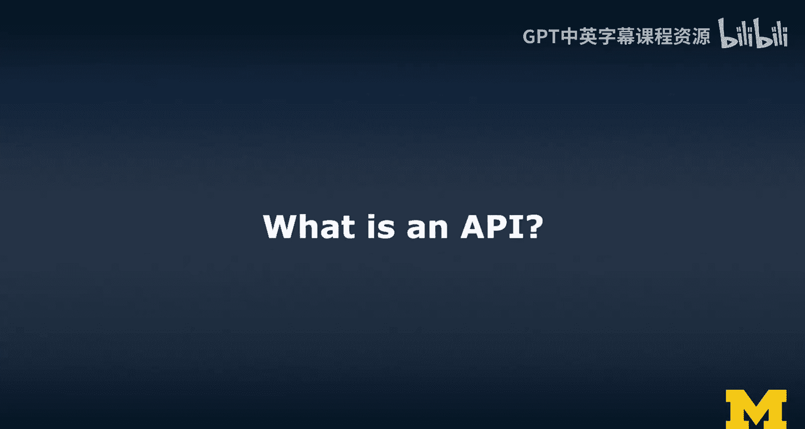
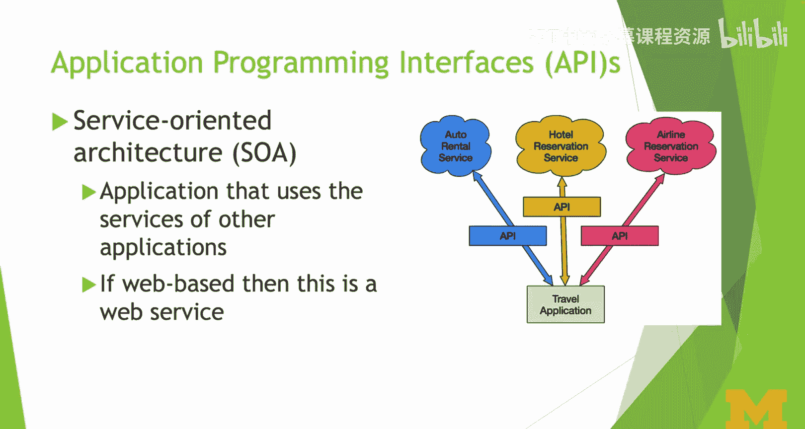
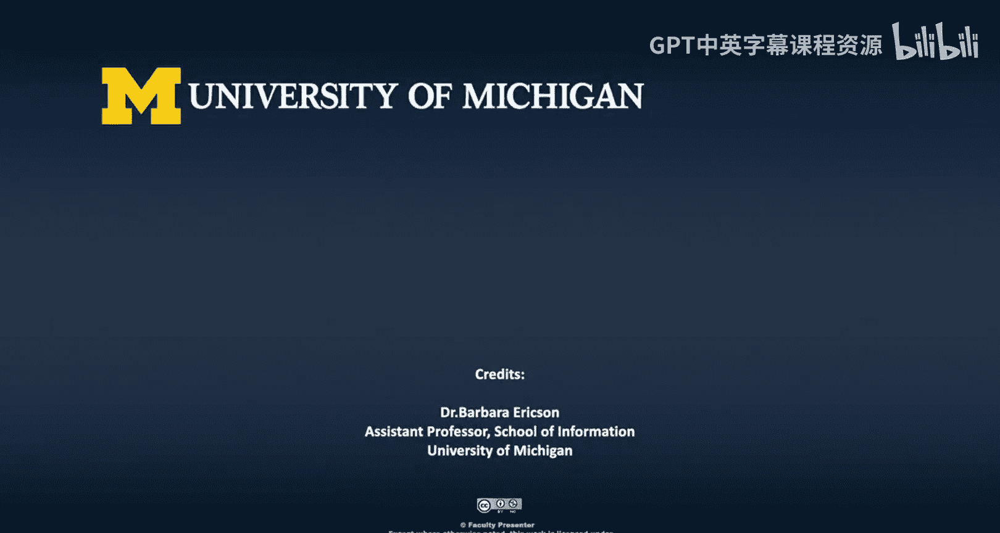

# 密歇根大学《创造性编程（创意、面向对象、debug、QA）｜Creative Coding： Hands-On Python》中英字幕 p161 28_API核心概念.zh_en -BV1ef421S7Bc_p161-

What does API stand for API means application programming interface。

 It's a way for two applications to communicate， one application can request data。

 the other one return data， and we tend to use these two formats we've just been learning about XML and JSON and more likely these days it's JSON that you're using。

And if you use everything， if one application is using the services of other applications。

 we call that as service oriented architecture or SOA， so for example。

 you may go to one website and your favorite book both a flight and a hotel and a rental car and none of that data is at that site。

 it is using APIs to contact other sites to get that information and to do that booking if everything's on the web we call this a web service。

