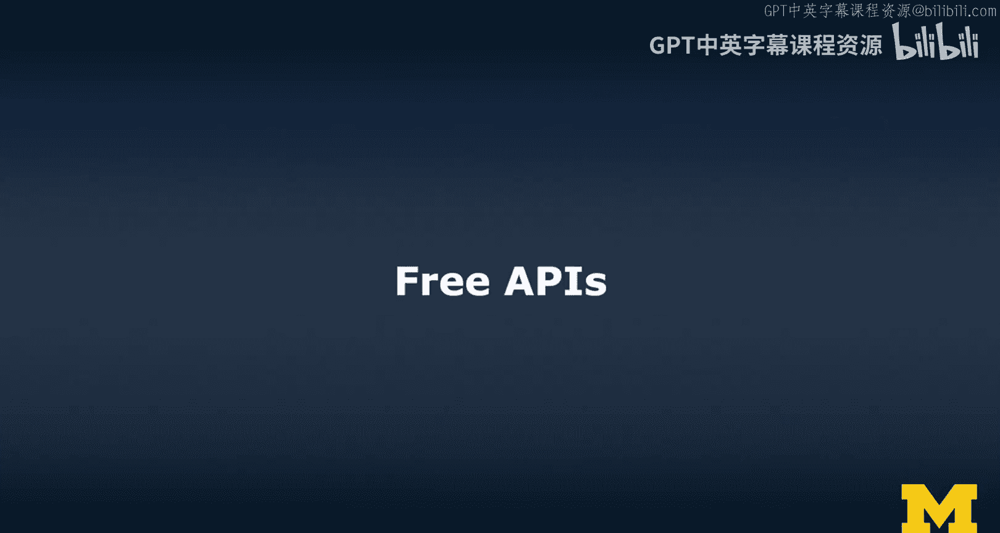
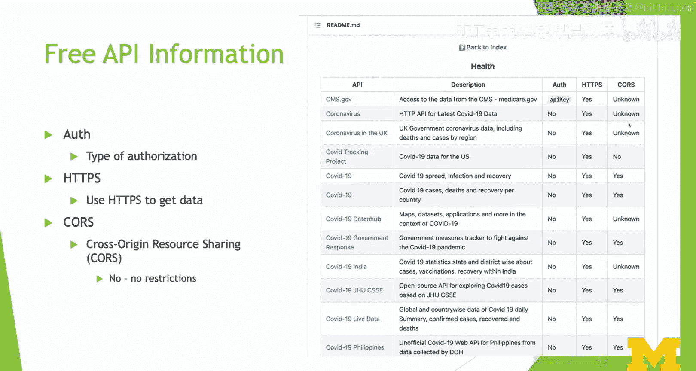

# 密歇根大学《创造性编程（创意、面向对象、debug、QA）｜Creative Coding： Hands-On Python》中英字幕 p162 29_免费API资源.zh_en -BV1ef421S7Bc_p162-

When you start working with APIs， it'd be helpful to have a list of what things you can work with。

 what kind of data can you get， what kind of authorization do you need And there is a nice Github repository at this URL that has a list of different topics here in the index if you scroll down when you go to that repository you'll see a list of things And once you click on something like health。

 for example， you'll see this information in a table that what's the API sort of name。

 you can click on that to actually go to the API what's the description of it。

 What kind of authorization is needed to access it， whether you need no authorization。

 you need API key or you need authorthization can use Hgtps typically yes。

 and then what's this course is crossor and resource sharing It's a way of protecting data and no means no restrictions。

 Yes， means there might be restrictions unknown you'd have to find out for yourself So once you find a free site For example one of the ones under animals is this free cat facts you can read the documentation to say。

 okay。

's the URL where I ask make requests and then you might add other endpoints or different endings to the URL so slash f gives me cat facts as you can see right here。

 So here's the original URL plus slash fax。 Sometimes the JSON is a bit hard to read this way so you might want to use a formatter so there's an online JSsonN format org you can just paste in the JSsonN and then click format beautify and you'll see it much in an easier way to process。

