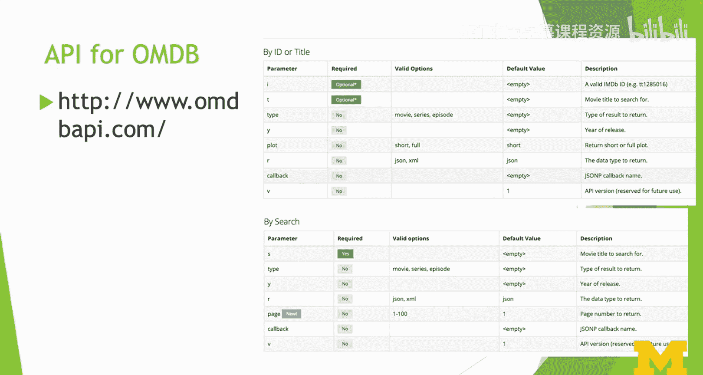

# 密歇根大学《创造性编程（创意、面向对象、debug、QA）｜Creative Coding： Hands-On Python》中英字幕 p163 30_API授权机制.zh_en -BV1ef421S7Bc_p163-

So when you're working with APIs， some APIs require an API key。

 they want to know who's using the service， they may limit how much you use it。

 they may even require billing information， and then some servers may require even stronger authorization called Oauthorization。

 and that's a framework that allows thirdparty applications to access web service and you can read more about that at this URL。

So if you find you have an API that you want to connect to that requires a key， so for example。

 the OMDB， the movie sort of database online， you can apply for one often so here if you go to Odbapi。

com/APpikey。asPX you can apply for a key you can do the free one it has a thousand daily limit should be fine you can click submit and it'll ask you for your information and then what you do is add to your request this API key equals and then your key。

So if you do that， you can also look at the API for it it'll tell you what kinds of things you can use like for search。

 you need required， you need an S parameter and what that is is the movie title to search for and you can also specify the type not required as movie series or episode。

 you can specify the why is the year of the release so when and every API is different so you have to go read the API documentation to figure out how do I get the information I want。

So here's an example of doing a search where I put in API key equals my actual key。

 and then you separate the different parameters with an ampers sand and s is the search looking for godfather and it takes any。

Unusual characters and translates them， so the quotes were translated to percent 22。

And this is what it returned， so it returned quite a bit of information about the godfather。

 so that's a little bit about how to use an API key。

