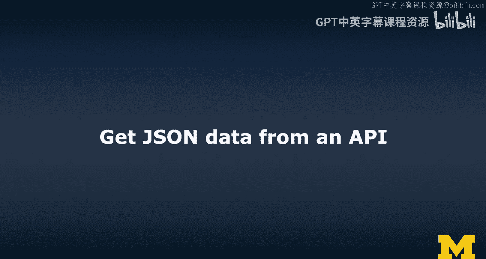
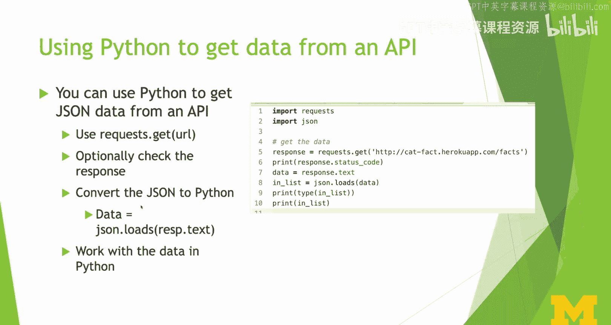
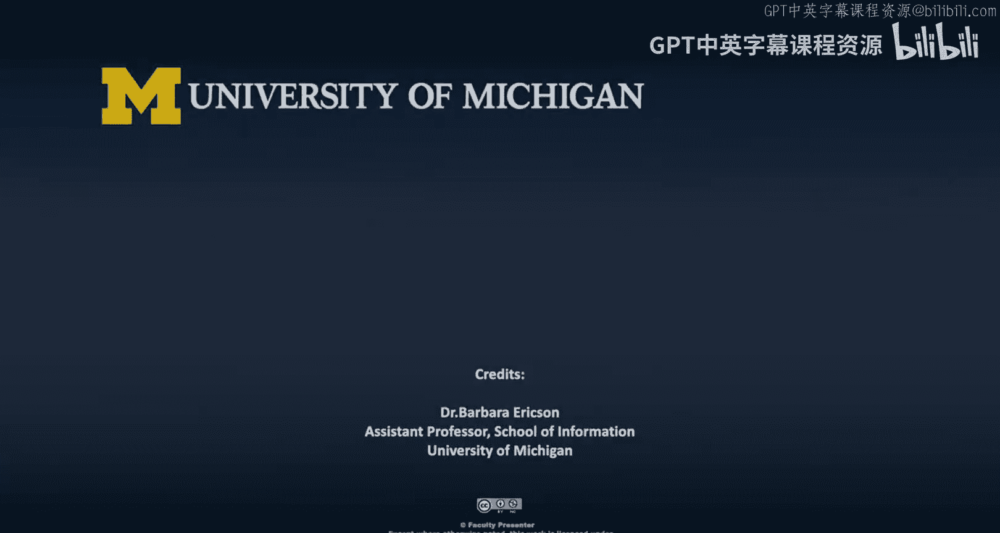
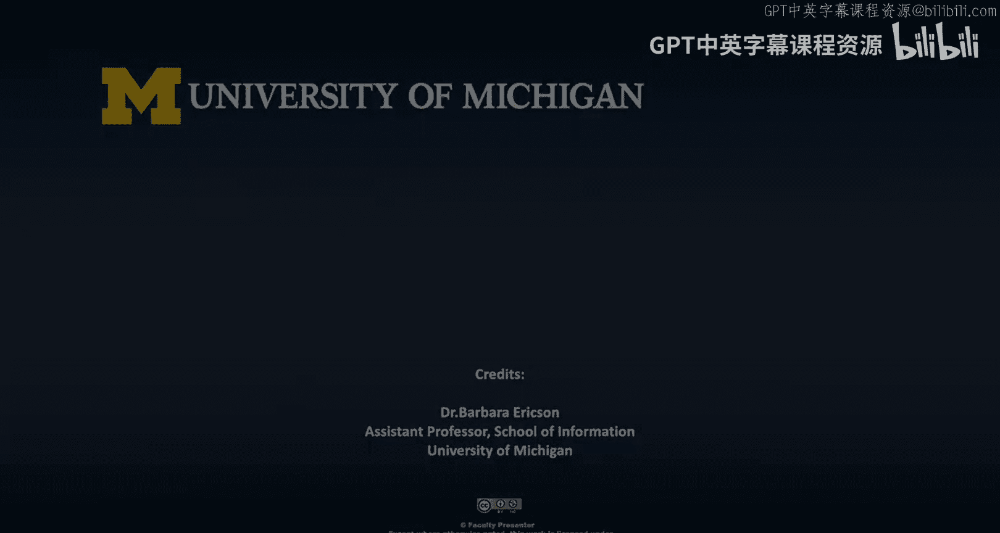

# 密歇根大学《创造性编程（创意、面向对象、debug、QA）｜Creative Coding： Hands-On Python》中英字幕 p164 31_从API获取JSON数据.zh_en -BV1ef421S7Bc_p164-

We can use Python to get data from an API， we can use the request。 get to get the URL。

 so however you have to assemble the request， and then we could print the status code from the response if it's 200 that means it's correct if it's like 404 means it wasn't found and we can get the data from the response so if we get the text to that data and we can use JON。

 loads of that response text in order to get either a list or a dictionary in this case it would be a list we could print the type of that thing we can actually print it。

So you can use， remember， you can use request。get， you can optionally check the results of the response to see if it was correct。

 if it worked or not， you can convert the JSON to Python objects and then you can work with the data in Python。

