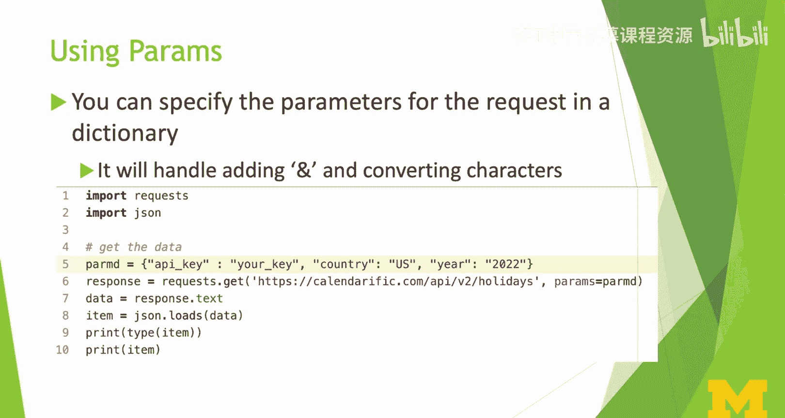

# 密歇根大学《创造性编程（创意、面向对象、debug、QA）｜Creative Coding： Hands-On Python》中英字幕 p165 32_使用params指定API参数.zh_en -BV1ef421S7Bc_p165-

You may have to specify an API key， there may be other search parameters that you have to specify and while you could create the string yourself with the ampersands between things and you could convert any special characters。

 there's an easier way， so you can use the request module you can have a dictionary that has the key and value pairs as strings that you need to request so for example for this one API that I'm working with。

 it'll tell me all the holidays for a particular country for a particular year。

 so I have to specify it does require an API key， so I have to specify the API key I would put my actual key here then what country I'm looking at US what year I'm looking at and I specify those by saying hey get request get of the base URL and then parameters equal and then that dictionary and when I do that then I get the data and it handles all of that creation for me。

