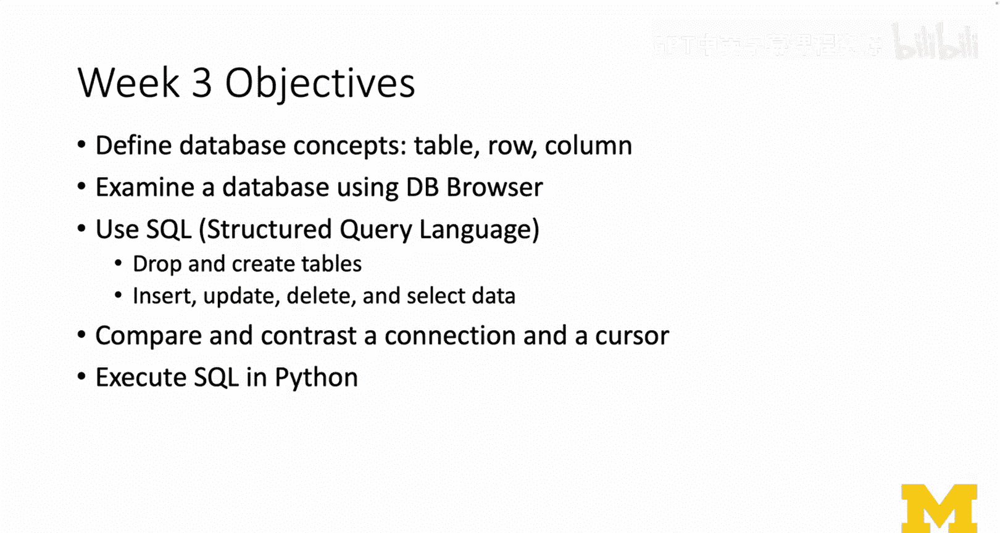
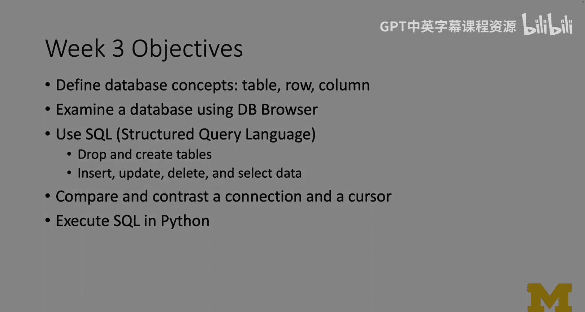
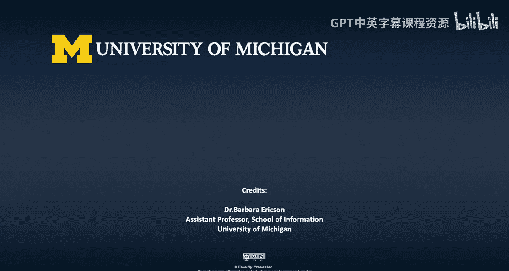

# 密歇根大学《创造性编程（创意、面向对象、debug、QA）｜Creative Coding： Hands-On Python》中英字幕 p166 33_欢迎进入第三周.zh_en -BV1ef421S7Bc_p166-

Welcome to week 3。 This week， you're going to start working with databases。

 which are really crucial to most businesses。 and we're going to learn about database concepts like what's a table。

 a row and a column or attribute。 You're going to examine databases and perhaps execute SQL using the Db browser and SQL stands for structured query language。

 Sometimes people call that SQL。 And it's the standard way that we interface with relational databases。

 So we're going to learn how to use SQL or SQL to drop and create tables， insert update。

 delete and select data。 and then we're going to use Python to work with databases。

 So we'll create a connection and a cursor and we'll describe what the differences are between connections and cursors and we'll execute SQL in Python。

 So enjoy。😊。

