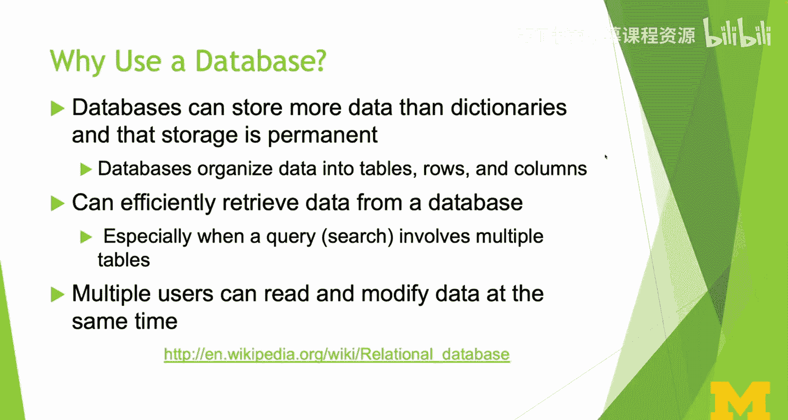

# 密歇根大学《创造性编程（创意、面向对象、debug、QA）｜Creative Coding： Hands-On Python》中英字幕 p167 34_为何使用数据库.zh_en -BV1ef421S7Bc_p167-

So why use a database and what's a database So database you can think of is likeA file in that it's permanent storage。

 so it exists even after you finish your program。And it's also like a dictionary in that it's easy to look up values given a key。

 So we can think of them as like dictionaries， but we can store a lot more data than we can store in the dictionaries。

 and that storage is permanent。 And then databases are organizing data into tables and tables can have rows and column。

 So like you see in a spreadsheet， and we can efficiently retrieve data given a key。

 we can retrieve data from a database。 that's really important。

 especially when your database gets really， really big。

 and we can search even when there's data across multiple tables。

 which there usually isn't a database， very key idea is that multiple users can read and modify data in a database at the same time。

 So if I am booking a flight or I'm trying to buy clothing online and thousands of other people are also doing that。

 we want to have a database to handle that load。😊。

