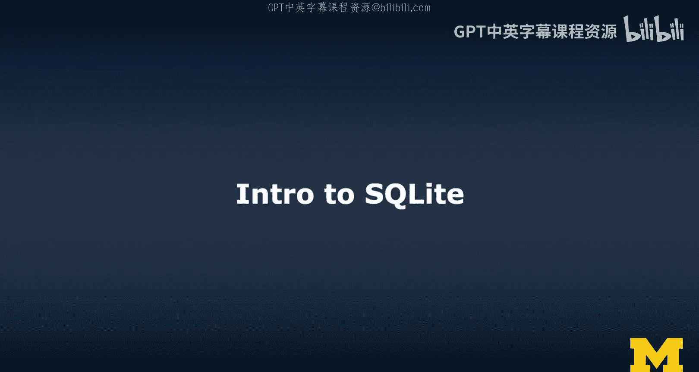
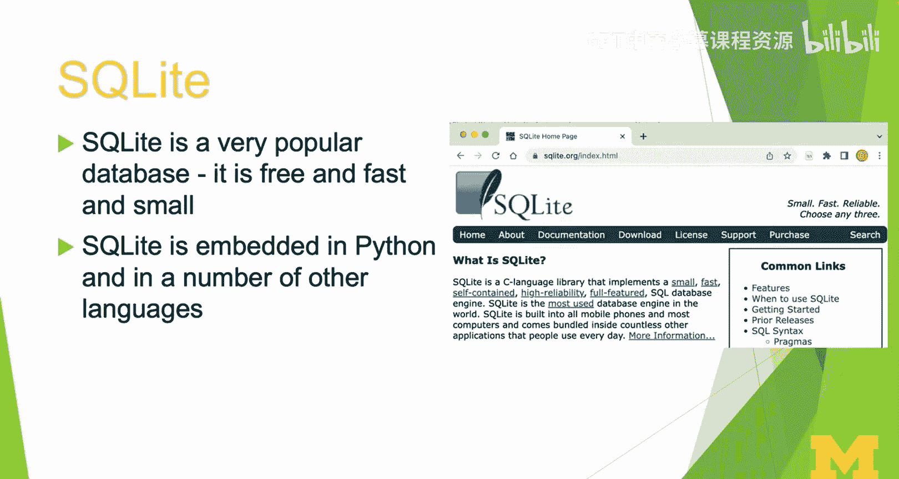
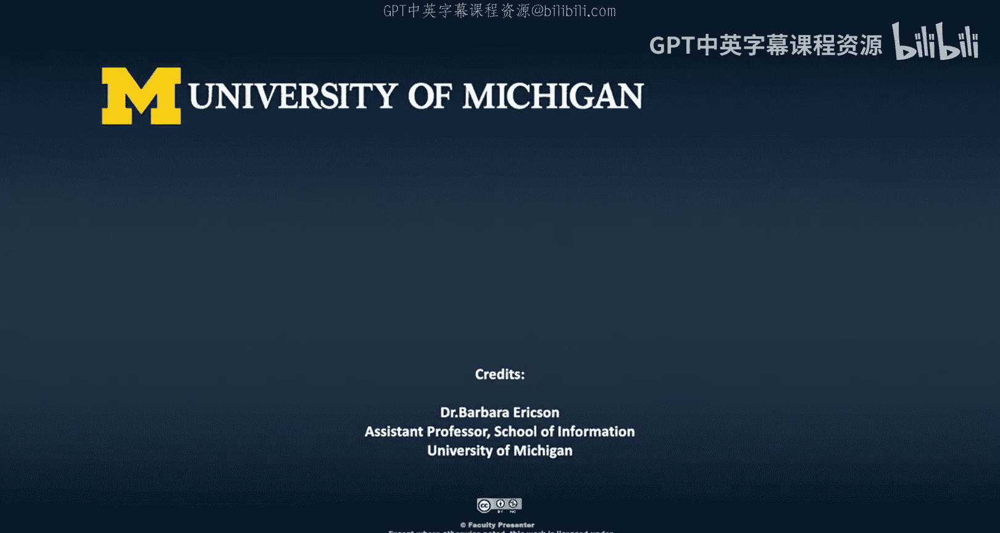

# 密歇根大学《创造性编程（创意、面向对象、debug、QA）｜Creative Coding： Hands-On Python》中英字幕 p168 35_SQLite入门指南.zh_en -BV1ef421S7Bc_p168-

We're going to use SQL light， and this is a very popular database that's free， fast and small。

 which is all the things that you want。 It's already embedded in Python and a number of other languages。

 So once you learn about it， you can use it and lots of things。

