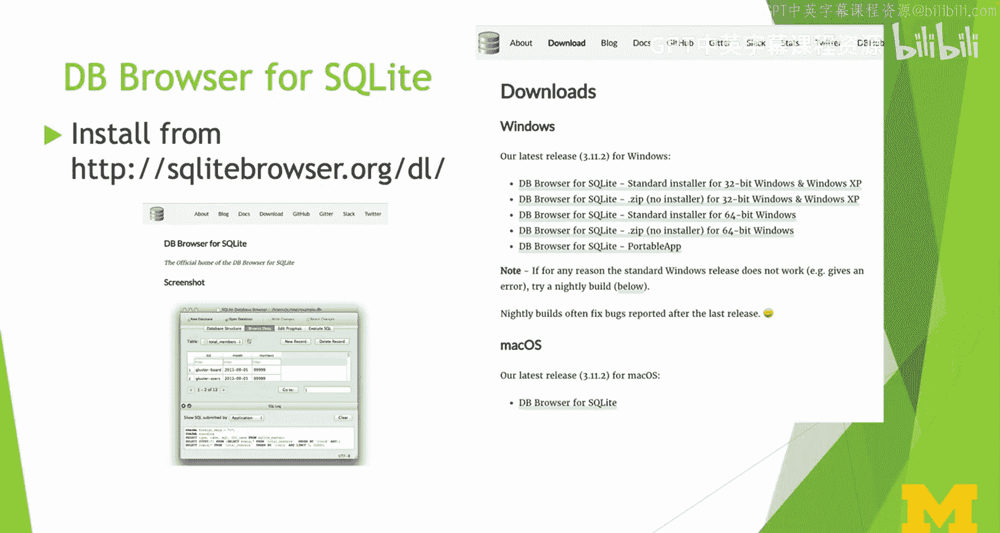
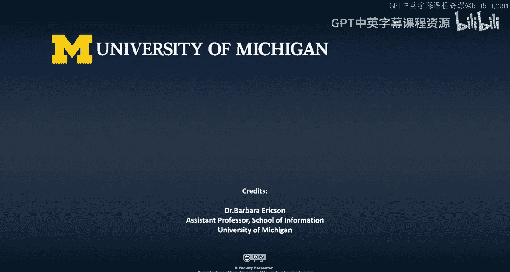

# 密歇根大学《创造性编程（创意、面向对象、debug、QA）｜Creative Coding： Hands-On Python》中英字幕 p169 36_DB Browser下载教程.zh_en -BV1ef421S7Bc_p169-

One of the things I recommend that you do is download the DB browser for SQL light and this is a free tool that you can use with a makes it graphical user interface to work with databases。

 make it easier to both view what's going on with your database as well as practice SQL commands so you can write select or create some things in it and execute it and see what the effect is so you can go to this URL and the Dl/dl will take you right to the downloads page and just find for your operating system the right one and install it This is a a view of what it looks like the tool looks like and I'm going to show you that on a practice database in just a moment。

