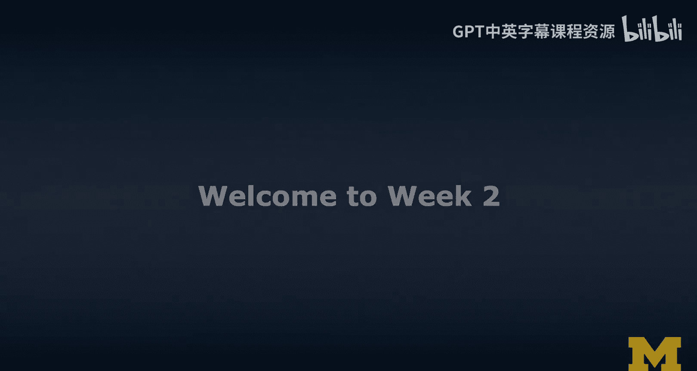
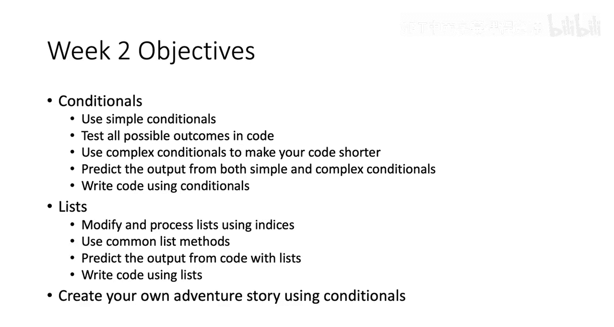
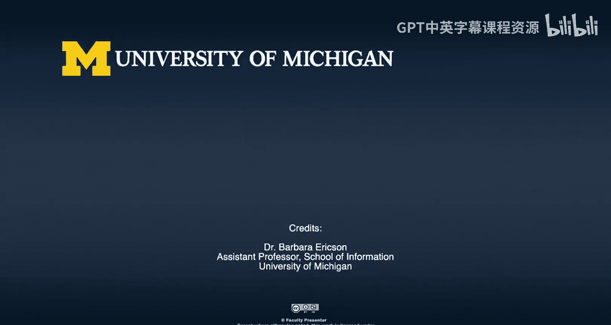

# 密歇根大学《创造性编程（创意、面向对象、debug、QA）｜Creative Coding： Hands-On Python》中英字幕 p17 16_欢迎进入第二周.zh_en -BV1ef421S7Bc_p17-

Welcome to week 2。 This week， you're going to focus on learning more about conditionals and lists。

 So with conditions， you're going to execute code if some condition is true or false and with lists。

 you can hold items in order。 So with conditionals。

 One one of the things you're going to do is learn how to use simple conditionals。

 test all possible outcomes in your code， Use complex conditionals to make your code shorter。

 Pre the output from both simple and complex conditionals and write code using conditionals with lists。

 you'll learn how to modify and process lists using indices。

 you'll use common list methods like aend or pop， You predict the output of code with lists and you'll write code using lists。

 At the end of the week， your assignment will be a create your own adventure store using conditionals。

 So enjoy。😊。

