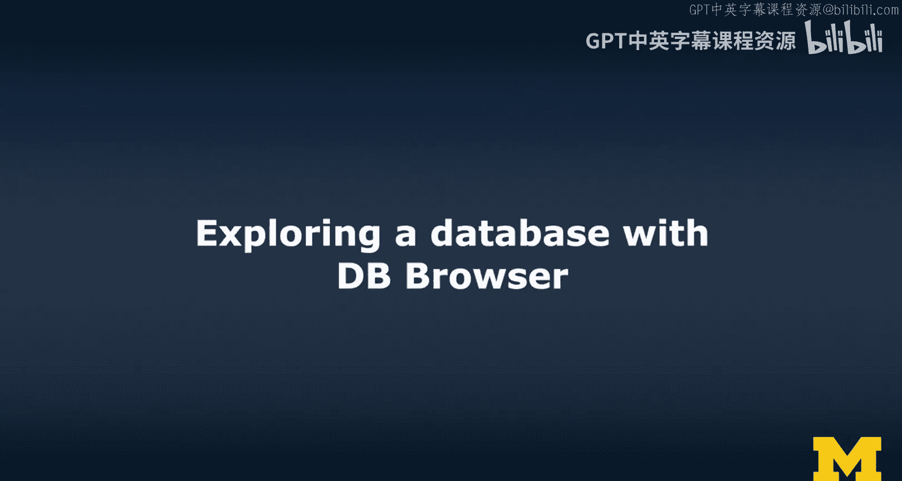
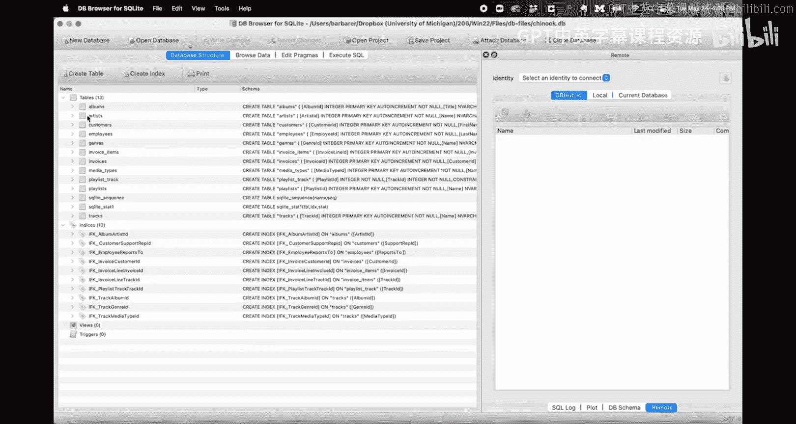
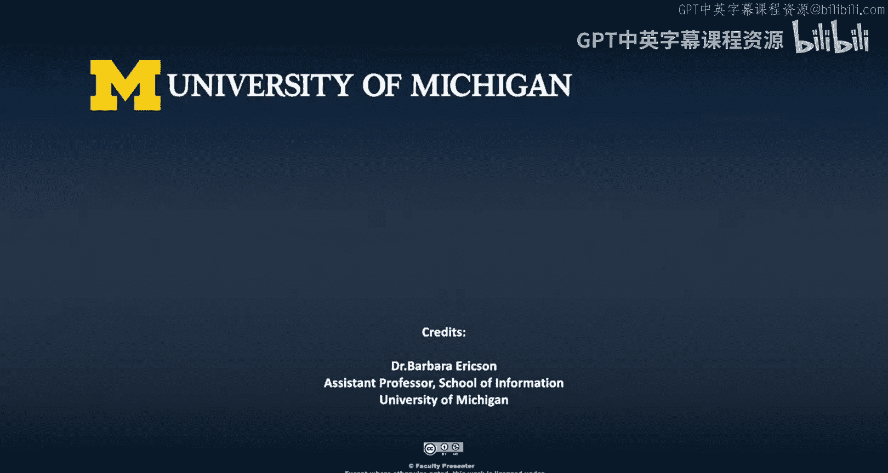

# 密歇根大学《创造性编程（创意、面向对象、debug、QA）｜Creative Coding： Hands-On Python》中英字幕 p170 37_使用DB Browser探索数据库.zh_en -BV1ef421S7Bc_p170-

So if you download a Db browser， what you I want you to do is open the Shiook。

db database and take a look at it And so you can do that by going up to open database here and then that'll bring up you can use this to navigate and so get to where you have your Chook。

 Db and then open it and you'll see。Here you can see your database structure。

 So there's different tabs here。 I can browse data so I can see data in different in different tables。

 So remember that in。Databases， relational databases， we have data broken into different tables。

 and you can think of each table as a different class or a representing a different entity or a different kind of thing。

 so that's why we think of it as a class or classification。And then in each table。

 you're going to have rows of data and the rows of data we can think about as an object of that class right so to describe one particular thing like these are albums so album would have you can have an ID to make it a primary key to find it easier but an album has a title and it has an artist who created the album。

 but notice we don't have the artist just put here we have instead an artist ID and a fully normalized relational database has lots of tables because we don't want any duplicate data。

So we can also look at what do we have an artist。 So for Art 1， we have that there are this band ADC。

 and there's except Aerosmith。 So we've separated out that albums have an artist。

 but what we do is put the artist I D in the album table， not the artist's name。 that way。

 we don't have duplicate strings when different albums can have the same artist。

 So instead we just have an Id。 So that takes up less space。 It also makes it very fast。

So we break databases into separate tables， each table represents an entity， a thing。

 and then we have rows that represent objects and then the columns represent particular data about that person。

 like for example， employees， there's a first name column and a last name column。

 so those are different attributes of an employee object of an employee or a person。

So that's a little bit about how to navigate a database and some of the database terminology。

 And so take a look at the different。Tables here in the Sch database and look at the database structure to look at all the tables。

 this is a fully functional relational database。

