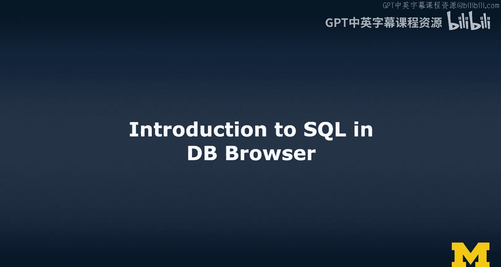
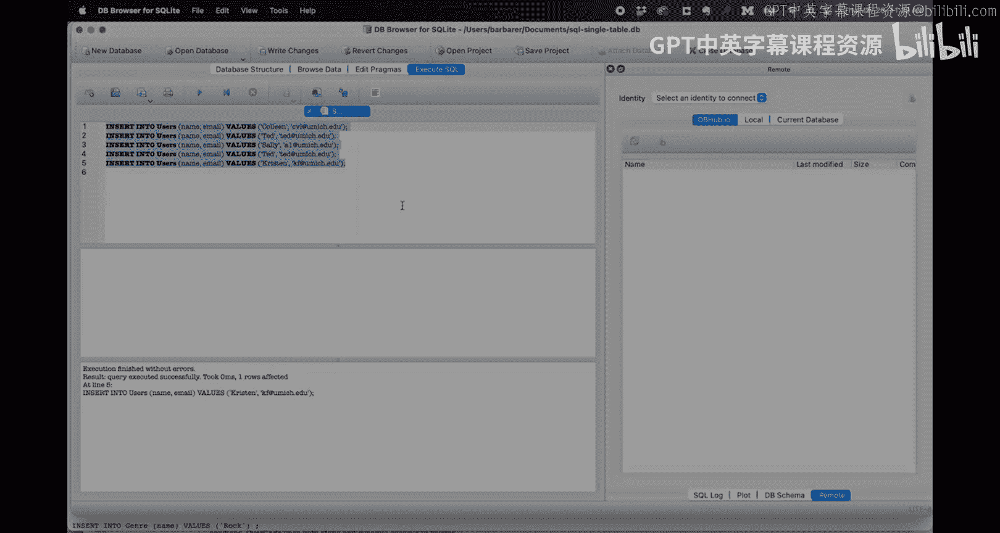

# 密歇根大学《创造性编程（创意、面向对象、debug、QA）｜Creative Coding： Hands-On Python》中英字幕 p171 38_DB Browser中的SQL基础.zh_en -BV1ef421S7Bc_p171-

We're going to learn more about SQL， which is structured query language。

 that's a standard language for working with databases。

 We're going to learn how to create data which using the insert command， retrieve data using select。

 we can also update data， which is the same name or delete data。Here's an example。

 We can use this file， which has some example SQL in it。

 and we can use the Db browser to see what happens。 So if I go to the Db browser。

 I'm going to create a new database。I'm going to give it a name。m。

This is a single table that we're creating。And I'm not saving what I've been doing。

 It's going to give us a way to pop up to start asking to create tables and walk us through that process。

 I'm going to cancel that because I'm just going to execute the SQL。

 And I was practicing some other stuff earlier。 So I'm going to clear that out。

 And I'm going to go and get the first line of this file。 This create table。 Try that out。

So if I execute， I can execute by clicking the play button， so it says that oh yes。

 you successfully did that， I can check if I look at the database structure。

 I see that there is a table called users that has two fields or attributes。

 name and email they're both text。 There is no data， however， in the database yet。

If I go back to that file and grab the next line。And now come back to Db browserrow。And execute SQL。

 I can replace this with that。And I can run that again。

 and I can see now when I go to browse data that there is data in the file， I mean in the database。

So I can go back to that file and I can do more than one line at a time。

So I'm going to grab the rest of those lines。And go back and execute SQL。

Now notice that we're inserting duplicate data here that we have Ted twice。

 so what do you think is going to happen is it going to restrict us from doing that or allow us to do that？

So make a prediction。And then let's see what happens。

 I'm going to go ahead and highlight all these because this will execute all the selector highlighted SQL。

But there's an error here because I need to have these separated by semi colons。

So whenever you have multiple lines here， I should put the semi Cols in。

So let's go ahead and do that。And it says it was successful， but it only says it did one row。

 let's go back and check。 So just so it did do this。

 but notice it did insert duplicate data because if we don't specify that the data can't be duplicate。

 it does allow it。So that's a quick introduction to how you can execute SQL in DB browser and you can keep going with those commands from the files to see what happens as you're creating a database。

 and this is very useful when you're practicing creating tables or practicing doing select statements to get data from tables so you can use this。

