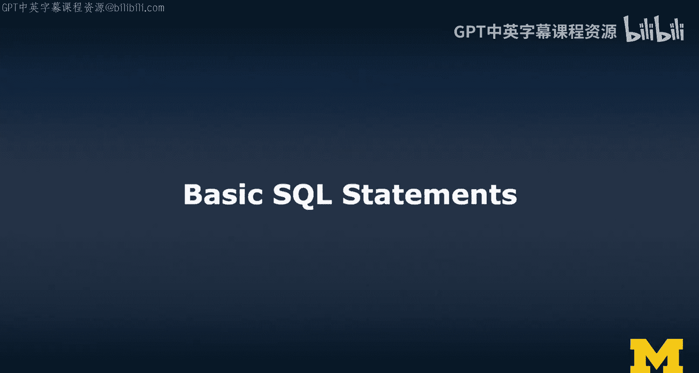
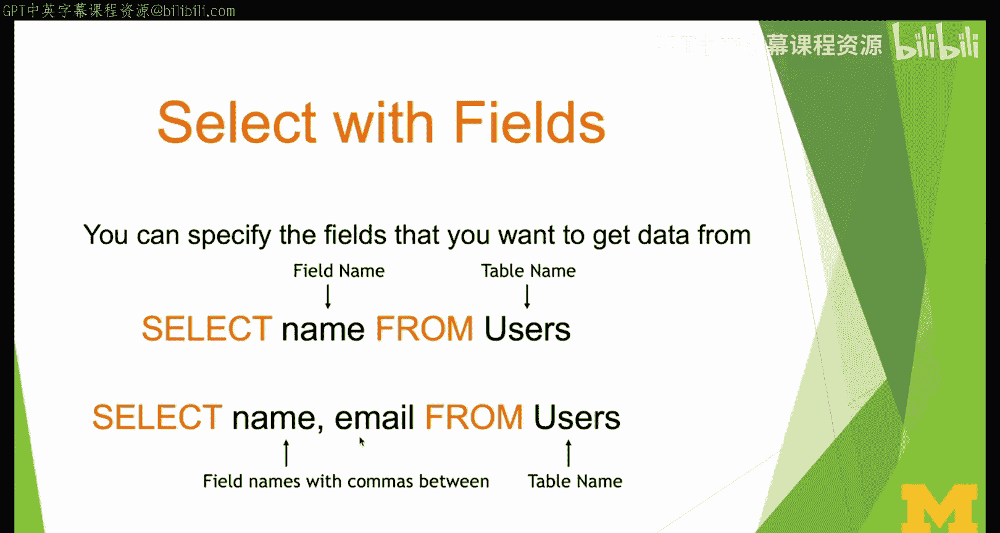

# 密歇根大学《创造性编程（创意、面向对象、debug、QA）｜Creative Coding： Hands-On Python》中英字幕 p172 39_基础SQL语句.zh_en -BV1ef421S7Bc_p172-

Let's go over some basic SQL statements that you can use to work with databases。

 So the first one is if you have just created a database。

 you need to start creating tables so you can use the create table statement for that。

 And we're showing the keywords in orange here and an all uppercase。

 but they don't have to be uppercase， but just to help say separate here what is keyword versus what is not So create table are keywords。

 then we have the table name So you give it a name And then in parentheses。

 you have a list of what are the column or fields and the types。

 So I have a name column and its type is text comma separating the fields or columns and then another column email and its type is also text you can think of text as string in Python。

So you can also insert data now that I've created a table I'd want to insert data into it。

 and so I use insert into you have to have both those keywords in that order and then what's the table name and then in parentheses a list of the field names and of course they should match whatever actual field names are so here we have field names of name and email So if we were inserting into this we would say name comm email。

 the order then matters as far as these values。We and then use the keyword values and then a list of the actual values you want to insert and they should match。

 so this should be the name and there should be the email。

You can remove or delete data from tables so you can say delete from again， those are the keywords。

 table name， you can optional add a where clause to limit where you're deleting where a column name or a field name is equal to some value。

 so you can limit that。You can modify or change data using the update statement。

 So update what table name you need the keyword then set。

 what column name equal to what column value。 And again。

 you can optional use the where clause to limit it with a column name equal to some column value。

 Notice they're using a single equal， not a double equal here。

You can grab data or retrieve data from a table using select， so you say select。

 you can use star to say all fields in the order that they're specified in a table from what table or you can also use aware clause again here to limit the data。

You can also specify what fields you want in what order。

 so I can say select a field name from a table name， and I'll just get back data from that field。

 or I can specify a list separated by commas， so that's a quick introduction to the basic statements in SQL。

