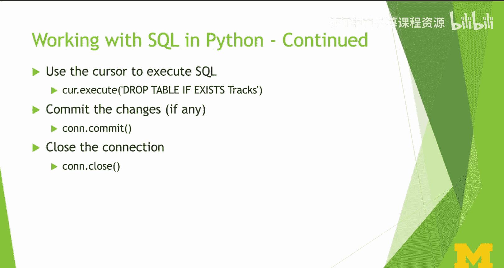

# 密歇根大学《创造性编程（创意、面向对象、debug、QA）｜Creative Coding： Hands-On Python》中英字幕 p173 40_Python执行SQL语句.zh_en -BV1ef421S7Bc_p173-

To work with SQL or SQL in Python， you， of course， have to do some setup。

 you have to import a module that knows how to work with that。 So that's import SQite 3。

 Then you create a connection to the database。 typicallyyp。

 a database is going to be on another computer。 We're going to work with it on our same computer。

 But often it's on different computer and the connection handles that communication。

 So we say Sql at 3 dot connect。 and then we give it the name of the database and that returns a connection object。

 and we save that。 We're calling it CO and N here。 Then we create a cursor object。

 And you can think of that as like a file handler。 So it knows how to read from a file。

 This knows how to execute SQl commands and process the results。

 So you'd say connection dot cursor or that creates a cursor object and returns it。

 And we're just calling it C R here。Next， you can actually execute then SQL using the cursor objects you say cursor。

 execute and then in a string you would specify what kind of SQL you want to run here we're saying drop a table if it exists。

 those are all keywords in SQL drop table if exists and then it's the name of the table so if that table exists。

 it will be deleted you don't want to do that when you already have a database that you're keeping around。

 but if you're just creating things from a file you might want to drop it first and then create things。

Then you want to commit your changes if you've made any。

 so a select statement just grabs data doesn't change anything in the database so you don't need to make commit then。

 but if you've deleted data， updated data， added data。

 then you'd want to commit using the connection and then you close the connection and that releases it so somebody else can use it because often many different people are using the same database at the same time so there could be multiple connections to it that's just a short summary of the basics of using Python to use to work with SQL。

