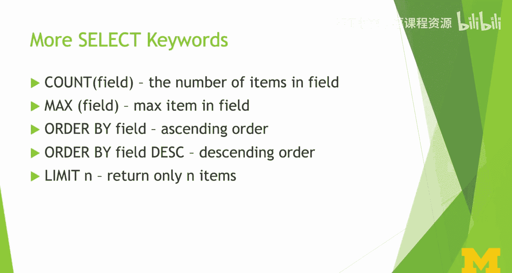
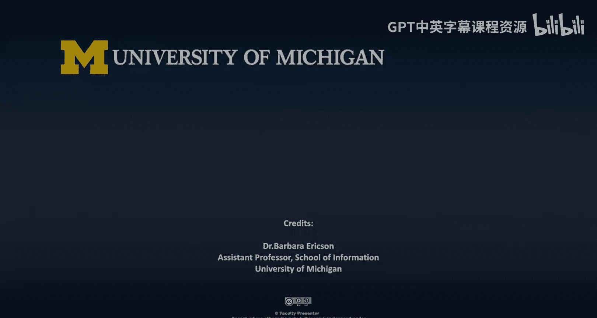

# 密歇根大学《创造性编程（创意、面向对象、debug、QA）｜Creative Coding： Hands-On Python》中英字幕 p174 41_SELECT进阶关键字.zh_en -BV1ef421S7Bc_p174-

There are more keywords you can use with the select statement in SQL。

 so you can say count and then a field in parentheses and that returns the number of items in that field in that table。

 you can say max and again， a field and parentheses and that'll return the max item in that field in that table。

 You can say order by a field and that will sort in acing order by that field。

 you can say order by field and then DC for descending and thatll return it in descending order。

 And you can also limit to n like n is a number， like 5。

 And that'll return only that n number of items then So those are just some of the additional keywords you can use with select。

